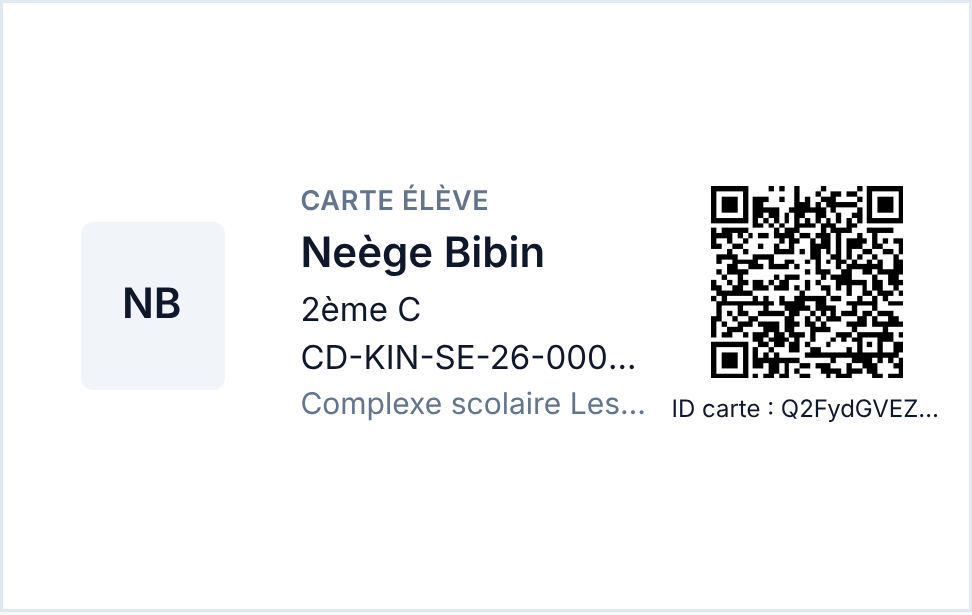
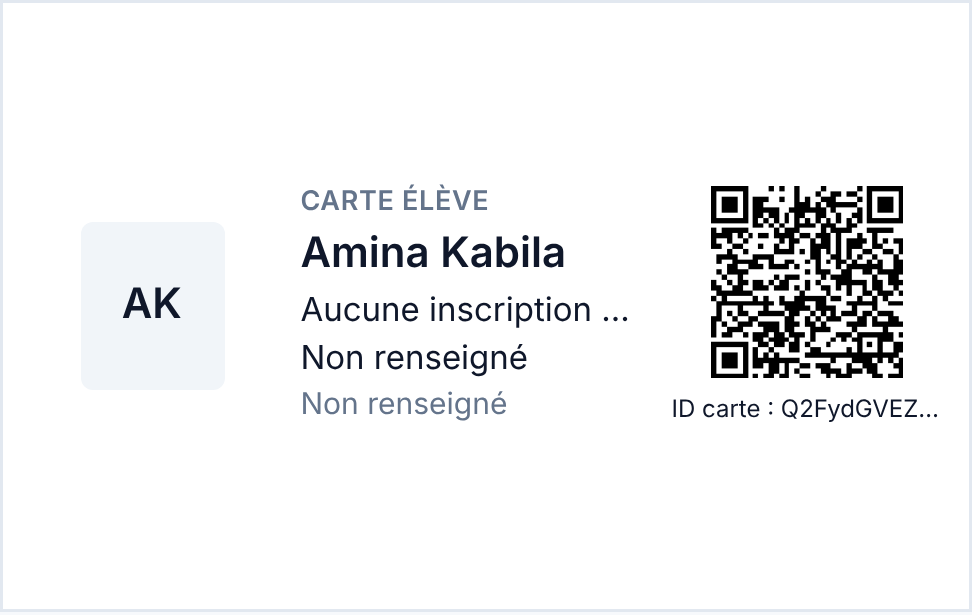
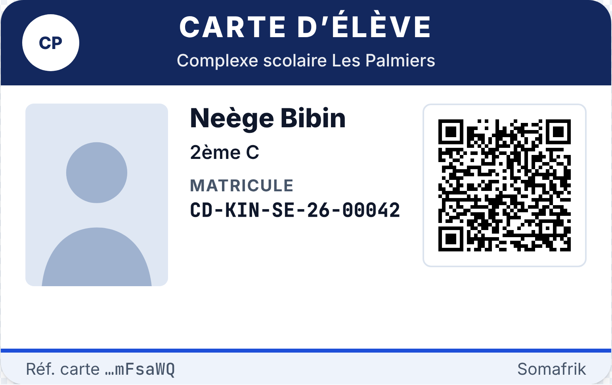
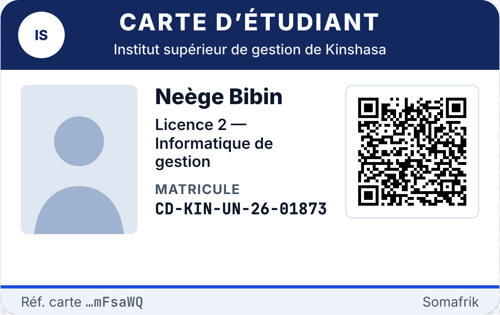
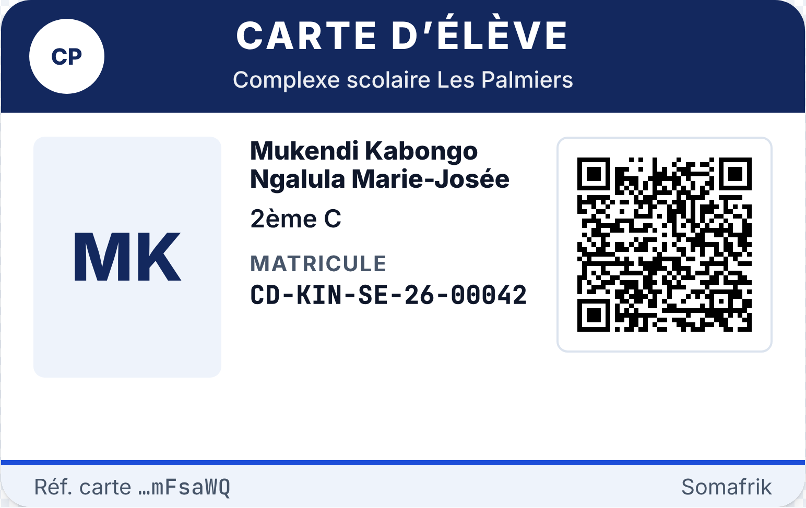
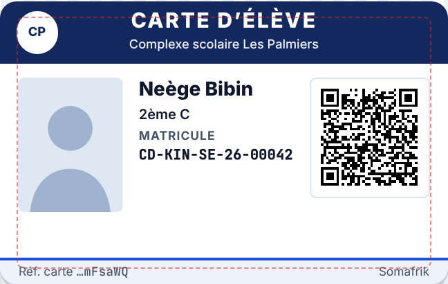
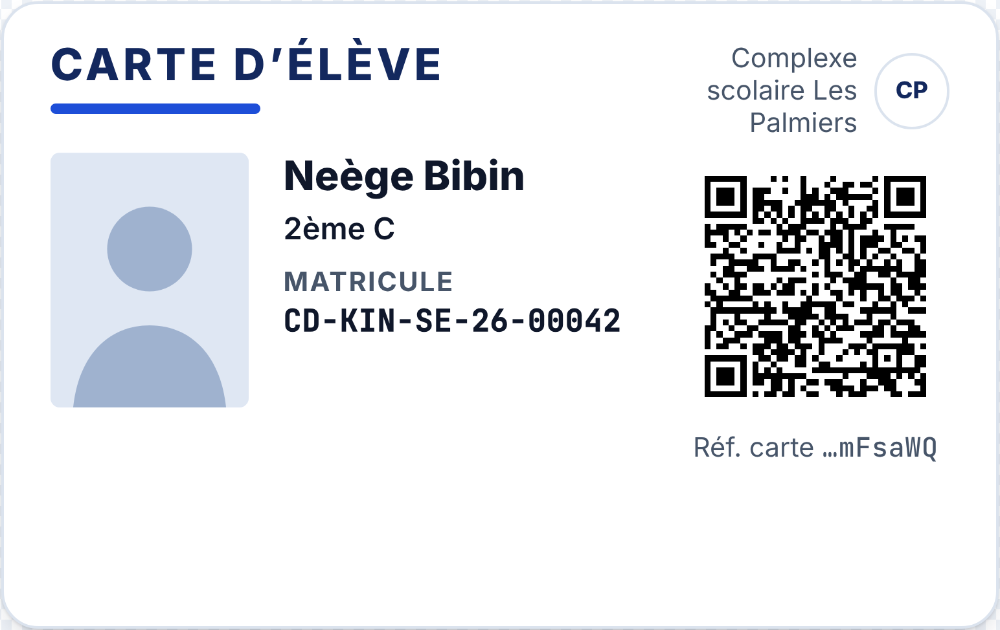
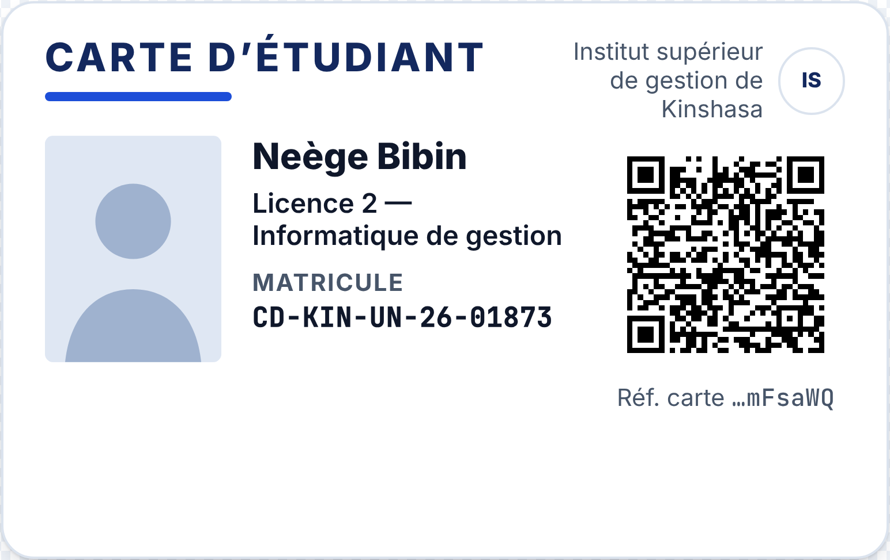
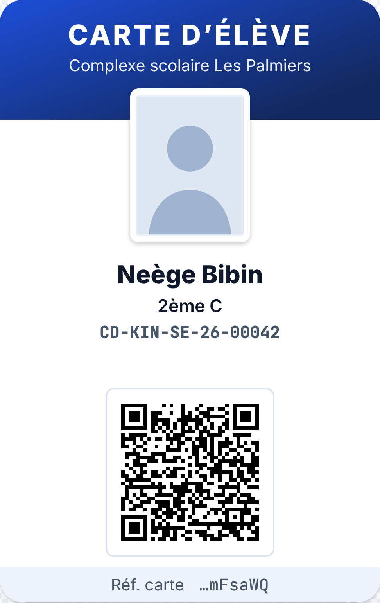
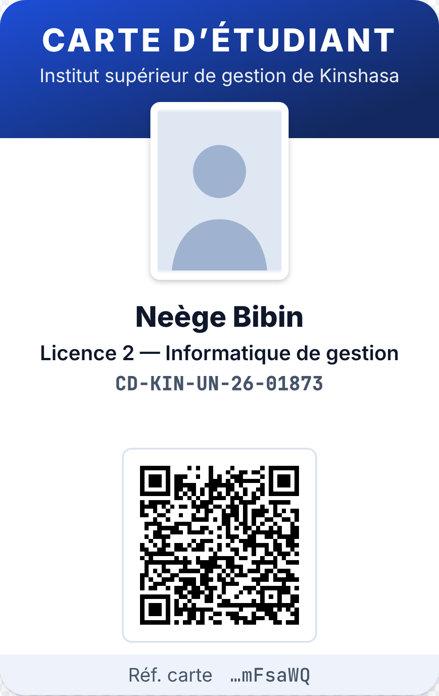

# AUDIT-CARTE-UI-01 — Amélioration visuelle Carte Élève Somafrik V2

**Statut : AUDIT / HOLD.** Aucune implémentation. Ce dossier contient uniquement de la documentation et des captures : aucun fichier produit n'est modifié.

| Référence | Valeur |
|---|---|
| `develop` audité | `6b30d950b0c449cdb2c5578b2899031f6790afa4` (merge #976, 21-10-2026) |
| PR #877 (CARTE-PR0, paramètres) | fusionnée le 06-10-2026, non modifiée |
| PR ouvertes touchant le rendu de la carte | aucune (19 branches Carte/NFC comparées à `develop`) |
| Données des maquettes | fictives ; QR factice (66 caractères, version 5) au format refusé par les lecteurs Somafrik |

Le rapport initial (inventaire, défauts, trois propositions, plan) est repris en synthèse dans la partie A. La partie B répond point par point au **complément CTO**.

---

## Partie A — Synthèse du rapport initial

### A.1 État actuel

- La carte n'existe que sur le **Web**, dans l'aperçu d'impression `web/src/components/students/StudentCardPrintView.tsx`. Cet aperçu n'est affiché **qu'une fois, à l'émission** : le jeton du QR n'est jamais réaffiché (`STUDENT_CARD_REPRINT_NOTICE`, `web/src/lib/studentCardPolicy.ts`).
- Le **Mobile** lit, encode et vérifie les cartes. Il n'en affiche aucune.

### A.2 Captures de l'existant

Rendu réel du composant (develop `6b30d950`, CSS Tailwind du projet, Chromium ×3).

| Cas nominal | Nom long | Données manquantes |
|---|---|---|
|  |  |  |
| Matricule et établissement tronqués | Nom, classe et établissement tronqués | « Aucune inscription active » et « Non renseigné » imprimés |

### A.3 Défauts, avec les priorités CTO

| Défaut | Preuve | Priorité CTO |
|---|---|---|
| QR sans marge blanche | `QR_OPTIONS = { margin: 0, width: 180, errorCorrectionLevel: "M" }` ; texte à 1 mm sous le QR | P1 |
| Matricule et nom tronqués | Classes `truncate` sur les 5 lignes de texte de `StudentCardPrintView.tsx` | P1 |
| En-tête petit et gris | `<p className="text-[9px] font-semibold uppercase tracking-wide text-muted">Carte élève</p>` | P1 |
| « Non renseigné » imprimé | `StudentCardTab.tsx` l. 218–224 : identité construite depuis `workspace.classLabel`, `schoolNameLabel`, `matriculeLabel` (repli `DEFAULT_MISSING_VALUE_LABEL = "Non renseigné"`, `studentWorkspaceViewModel.ts` l. 80) | P1 |
| Police Inter non chargée | `web/tailwind.config.js` déclare Inter ; aucun `fonts.googleapis` ni `@font-face` dans `web/index.html` ou `web/src/index.css` | P2 |
| Espace inutilisé | Grille `grid-cols-[22mm_1fr_24mm] items-center` : environ 40 % de la hauteur reste vide | P2 |

---

## Partie B — Complément CTO

### B.1 Les six valeurs de `schools.school_type`

**Liste exacte**, déclarée deux fois à l'identique :

- `web/src/lib/schoolModule.ts` l. 6–14, commentaire « Types d'établissement Somafrik (liste contrôlée ETB-F01) » ;
- `backend/lib/schoolModule.js` l. 4–11.

```
"École primaire"
"Collège"
"Lycée"
"Université"
"Institut"
"Centre de formation"
```

**Stockage et validation :**

- Colonne `school_type TEXT` (`backend/db/schema.sql` l. 32), **sans contrainte CHECK**.
- La liste n'est imposée que par l'interface Web : `validateSchoolForm` vérifie seulement que le champ n'est pas vide (`web/src/lib/schoolModule.ts` l. 55), et la liste déroulante vient de `SchoolsPage.tsx` l. 694. **Le Backend n'applique aucune liste.**
- L'écran Profil établissement réinjecte la valeur existante si elle est hors liste (`EstablishmentProfilePage.tsx` l. 120). Le filtre de `SchoolsPage.tsx` l. 123 ajoute aussi les valeurs déjà présentes en base.

**Valeurs hors liste trouvées dans le code :**

| Valeur | Fichier |
|---|---|
| `"Établissement"` (défaut à la création si le type est absent) | `backend/db/schoolsRepository.js` l. 196 ; repli de lecture `backend/lib/schoolsManagement.js` l. 181 |
| `"Établissement secondaire"` | `backend/lib/demoPublicPlatformSeed.js` l. 58 |
| `"Démonstration"` | `backend/lib/demoPublicPlatformSeed.js` l. 469 |
| `subscription?.schoolType ?? "Collège"` (valeur venue de l'abonnement) | `backend/lib/repairOrphanSchools.js` l. 76 |

**Côté Web, au moment de l'impression :** le type est disponible dans `School.type` (`web/src/types.ts`, champ facultatif `type?: string`), à travers `useOptionalActiveSchool()` déjà utilisé par `StudentCardTab.tsx` l. 76 et transmis à l'aperçu (l. 247).

**Autres sources de cycle :**

- `school_settings` contient des colonnes typées (`backend/db/schema.sql` l. 423–438), dont les cinq indicateurs carte. **Aucune ne porte le cycle.**
- Les niveaux d'enseignement (`EducationLevel` : `code`, `name`, `displayOrder`, `web/src/lib/educationReferenceApi.ts`) **n'ont pas non plus de champ cycle**.

> **Conclusion.** Aucune donnée existante ne dit de façon fiable si un établissement relève du cycle inférieur ou supérieur. Seul `school_type` permet une déduction, et seulement pour une partie des valeurs.

### B.2 Matrice de correspondance proposée

| `school_type` (exact) | Cycle | En-tête | Statut |
|---|---|---|---|
| `École primaire` | inférieur | **CARTE D'ÉLÈVE** | déterminé |
| `Collège` | inférieur | **CARTE D'ÉLÈVE** | déterminé |
| `Lycée` | inférieur | **CARTE D'ÉLÈVE** | déterminé |
| `Université` | supérieur | **CARTE D'ÉTUDIANT** | déterminé |
| `Institut` | ambigu | aucun | **non déterminé** |
| `Centre de formation` | ambigu | aucun | **non déterminé** |
| Valeur hors liste (`Établissement`, `Établissement secondaire`, `Démonstration`, saisie libre…) | inconnu | aucun | **non déterminé** |
| Absent ou vide | inconnu | aucun | **non déterminé** |

Règle de comparaison proposée : égalité exacte après `trim()`. Pas de recherche de mots-clés, pas de tolérance sur les accents. Une valeur inattendue ne doit jamais produire de libellé par hasard.

### B.3 Cas ambigus

1. **`Institut`** : en RDC, ce mot désigne aussi bien des écoles **secondaires** (instituts techniques ou commerciaux, humanités) que des établissements **supérieurs** (« Institut supérieur… »). Le type seul ne permet pas de choisir.
2. **`Centre de formation`** : formation professionnelle, pour un public jeune ou adulte, et sans rattachement au supérieur. Conformément à l'arbitrage CTO, **jamais classé supérieur automatiquement**.
3. **Valeur libre ou héritée** : `school_type` est un texte libre côté Backend, et des valeurs hors liste existent déjà dans le code.
4. **Type absent** : `School.type` est facultatif côté Web, et la création applique `"Établissement"` par défaut.
5. **Établissement mixte** :
   - un complexe maternelle, primaire et secondaire n'a qu'un cycle (inférieur), donc pas de difficulté ;
   - en revanche, une université avec une école d'application, ou un institut avec une section secondaire et une section supérieure, mélange deux cycles. Il n'y a **qu'un seul `school_type` par établissement**, et ni les niveaux ni les classes ne portent de cycle : **la distinction par élève est impossible avec les données actuelles**.

**Comportement sûr proposé lorsque le cycle n'est pas déterminé.** Décision CTO.

| Option | Effet | Impact |
|---|---|---|
| **B (cible recommandée)** : réglage explicite du titulaire par établissement (`élève` ou `étudiant`), avec éventuellement une surcharge par niveau pour les établissements mixtes | Plus aucune déduction | **Hors refonte visuelle.** Une colonne dans `school_settings` demande une migration ; une clé dans `schools.profile_payload` évite le DDL mais modifie le contrat des paramètres. Mandat séparé, par exemple CARTE-CYCLE-01. |
| **A (transitoire)** : si le cycle n'est pas déterminé, « Émettre une carte » est désactivé, avec le message « Cycle de l'établissement non configuré » | Aucun libellé n'est attribué au hasard. L'émission doit être bloquée **avant** l'émission, sinon le jeton serait perdu. | Change le parcours d'émission pour les établissements « Institut », « Centre de formation » ou de type libre. |
| C : libellé neutre « CARTE SCOLAIRE » | Impression toujours possible | Contraire à la règle des deux libellés. Seulement si le CTO l'accepte. |

### B.4 Identifiant affiché sous le QR (« ID carte »)

**Nature : identifiant public. Ce n'est ni un secret, ni un identifiant interne de base de données.**

- **Génération** (`backend/lib/studentAccessCardsManagement.js` l. 35–36 et 56–71) :
  - `publicId = crypto.randomBytes(16).toString("base64url")`, soit 22 caractères ;
  - `secret = crypto.randomBytes(32)` ;
  - seul `token_hash = sha256(secret)` est stocké. Le secret n'est jamais conservé.
- **Contenu du QR** : `cardToken = "${publicId}.${secret}"`. Le `publicId` est donc **déjà la première partie du QR**, lisible par toute application de lecture de QR.
- **Ce qu'il autorise : rien, à lui seul.**
  - Le provisionnement NFC exige le jeton complet comparé à son empreinte (`assertProvisionable`, `backend/lib/studentCardsNfcLifecycle.js`, #974).
  - La vérification et le scan exigent le jeton complet (`parseCardToken`, `backend/lib/studentCardCapability.js` l. 16).
- **Où il est affiché** :
  - liste des cartes du Web (`StudentCardTab.tsx` : « ID carte : … ») ;
  - réponse `GET /api/students/:id/cards` (droit Élèves:READ).
- **Distinct de l'identifiant interne** `student_access_cards.id` (UUID), qui n'est jamais affiché.

**Traitement proposé, conforme à l'arbitrage « masqué ou abrégé » :**

- Afficher **« Réf. carte …XXXXXX »**, soit les 6 derniers caractères, en chasse fixe et en gris discret, dans le pied de carte.
- Le distinguer du matricule par l'intitulé, la position et le style : le matricule est intégral, en gras, sous l'intitulé « MATRICULE ».
- La référence complète reste dans le back-office.
- **Le contenu du QR n'est pas modifié.**

### B.5 Photos d'élèves et autorisations

- **Colonne** : `students.photo_url TEXT` (`backend/db/schema.sql` l. 249).
- **Écriture** :
  - toutes les insertions d'élèves écrivent une chaîne vide (`photo_url` = `''`) : l'inscription (`backend/db/classStudentsRepository.js` l. 462–470), l'import et la synchronisation (`backend/db/postgresRepository.js` l. 4699–4700) et le seed (l. 5632–5633) ;
  - **aucun chemin de mise à jour de `photo_url` n'a été trouvé** dans le Backend. L'envoi de photo existant (`clientsRolePolicy.js` l. 20) concerne les **comptes utilisateurs**, pas les élèves.
- **Lecture** : le dossier élève (`photoUrl`), la résolution de scan (`studentAccessCardsManagement.js` l. 524) et l'aperçu de carte (`dossier?.photoUrl`).
- **Politique d'autorisation** : **aucune** dans le code ni dans la documentation. Il n'existe ni consentement, ni droit à l'image, ni indicateur d'autorisation. Le seul document qui en parle, `docs/audits/AUDIT-CARTE-01-eleve-presence-nfc-qr-impayes.md` §9.6, écrit « photo URL **autorisée** » sans définir la règle.

**Conséquences :**

- Aujourd'hui, aucune carte ne peut afficher de photo : ce sont toujours les initiales.
- L'arbitrage CTO (« photo si disponible, sinon initiales ») est compatible : la photo n'est rendue que si l'URL n'est pas vide.
- **Avant tout futur envoi de photos d'élèves**, il faudra une règle de consentement explicite (mineurs). C'est hors de ce chantier visuel.

### B.6 Maquette P1 agrandie

Échelle 9 px par mm. Filigrane masqué pour la lisibilité. Toutes les données sont fictives et le QR est factice.

**Les deux en-têtes, avec photo :**

| CARTE D'ÉLÈVE | CARTE D'ÉTUDIANT |
|---|---|
|  |  |

**Identité longue, sans photo :**

| Élève, nom très long, initiales | Étudiant, nom très long, classe longue, initiales |
|---|---|
|  |  |

**Identité longue, avec photo :** 

**Simulation PVC à l'échelle 1:1** (pointillé rouge : zone de sécurité de 3 mm) : 

**Spécifications P1, en millimètres de carte CR80 (85,60 × 53,98) :**

| Élément | Valeur |
|---|---|
| Bandeau | 12 mm, bleu nuit `#13285e`. En-tête « CARTE D'ÉLÈVE » ou « CARTE D'ÉTUDIANT » en majuscules et gras 800, 4 mm (environ 11,3 pt), blanc, centré. Nom de l'établissement 2,4 mm (6,8 pt) sous l'en-tête. Logo de l'établissement dans une pastille blanche de 8 mm. |
| Nom | Gras 800, 3,7 mm (10,5 pt), **toujours intégral** : il passe à 3,05 mm puis à 2,7 mm (7,6 pt) selon la longueur, au lieu d'être tronqué. |
| Classe | 2,65 mm (7,5 pt), sur plusieurs lignes si nécessaire. |
| Matricule | Intitulé « MATRICULE » 2,3 mm, valeur en chasse fixe et grasse 2,65 mm, **intégrale**. |
| Photo | 20 × 25,7 mm (ratio d'identité 7:9), ou initiales sur fond `#eef3fb`. |
| QR | 23 mm au total, dont 2 mm de marge blanche de chaque côté, soit un QR de 19 mm. Module d'environ 0,51 mm, zone de silence de 3,9 modules et plus, au-delà des 4 modules une fois le blanc de la carte compris. |
| Pied | 5 mm : « Réf. carte …XXXXXX » à gauche, « Somafrik » discret à droite. Texte 2,3 mm (6,5 pt). |
| Taille minimale de texte | 6,5 pt partout. |

**P2 et P3, captures finales** pour comparaison :

| P2 Sobre, élève | P2 Sobre, étudiant |
|---|---|
|  |  |

| P3 Portrait, élève | P3 Portrait, étudiant |
|---|---|
|  |  |

### B.7 Séparation du composant visuel et de la génération du jeton QR

**Aujourd'hui**, `StudentCardPrintView` fait tout : il reçoit `cardToken`, appelle `QRCode.toDataURL`, met en page la carte et gère l'impression.

**Proposition** : quatre unités, une seule mise en page, et un seul endroit où le jeton est manipulé.

| Unité | Rôle | Jeton |
|---|---|---|
| `useStudentCardQr(cardToken)` (hook, à côté de `StudentCardPrintView`) | Seul appel à `QRCode.toDataURL(cardToken, QR_OPTIONS)`. Renvoie `{ state: "loading" \| "ready" \| "error", src, retry }`. | **Oui, uniquement ici.** |
| `StudentCardFace` (nouveau, `web/src/components/students/StudentCardFace.tsx`) | Mise en page pure de la maquette retenue. Props : `holderLabel`, `identity` (valeurs brutes et facultatives, lignes vides masquées), `cardRef` abrégée, `logoSrc`, `qr: { kind: "ready", src } \| { kind: "loading" } \| { kind: "error" } \| { kind: "specimen" }` | **Non** : aucune prop ne reçoit le jeton (garanti par le type et vérifié par un test). |
| `StudentCardPrintView` (existant, allégé) | `useStudentCardQr`, `StudentCardFace`, `PrintButton`, Terminer. Comportement inchangé : Imprimer désactivé tant que le QR n'est pas prêt. | Reçoit le jeton et le passe au hook. |
| `StudentCardSpecimenPreview` (PR-UI-2) | `StudentCardFace` avec `qr.kind = "specimen"` : SVG statique d'un texte non conforme au format du jeton, et filigrane « SPÉCIMEN ». Aucun appel API, aucune émission. | **Aucun.** |

**Fonctions pures associées**, dans `web/src/lib/studentCardPolicy.ts` :

- `studentCardHolderLabel(schoolType): "CARTE D'ÉLÈVE" | "CARTE D'ÉTUDIANT" | null`, selon la matrice B.2 (`null` = non déterminé) ;
- `studentCardRef(publicId)` : 6 derniers caractères ;
- `buildStudentCardFaceIdentity(...)` à partir des valeurs brutes, sans libellés d'écran.

**Contenu du QR inchangé** : même `cardToken`, même correction M. Seuls la marge et la taille d'affichage changent.

### B.8 Plan de tests

**Tests unitaires Web** (vitest, dans les suites existantes) :

- **Conservés** : `StudentCardPrintView.test.tsx`
  - QR appelé avec le jeton exact ;
  - feuille CR80 de 85,60 × 53,98 mm ;
  - Imprimer désactivé pendant le chargement ou en cas d'erreur ;
  - aucun jeton ni `parentPhone` dans le DOM ;
  - logo de l'établissement.
- **Également conservés** : `StudentCardTab.test.tsx`, `studentCardPolicy.test.ts`, `StudentCardSettingsSection.test.tsx`.
- **Nouveaux** :
  - `studentCardHolderLabel` : les 6 valeurs, hors liste, vide, `undefined`, espaces ;
  - `Institut` et `Centre de formation` donnent `null` ;
  - aucune chaîne « Non renseigné » ni « Aucune inscription active » dans la carte ; une ligne absente est masquée ;
  - nom de 45 caractères et matricule de 24 caractères présents **en entier** dans le DOM, sans classe `truncate` ;
  - `StudentCardFace` ne reçoit et n'affiche jamais le jeton (texte et attributs) ;
  - options QR avec marge ≥ 4 modules ; référence de carte abrégée sur 6 caractères ;
  - spécimen : aucun appel API, et le contenu du QR ne respecte pas le format `^[A-Za-z0-9_-]{22}\.[A-Za-z0-9_-]{43}$`.

**Recette visuelle :** captures Chromium à 3 ppp des cas en-tête élève ou étudiant, photo ou initiales, nom standard ou très long. Aucun débordement ni chevauchement.

**Impression :**

- Chrome et Edge à jour, sous Windows.
- Imprimante CR80 recto (type Evolis ou Zebra) et laser A4 à l'échelle **100 %** (sans « Ajuster à la page »).
- Mesures à la règle : 85,6 × 54,0 mm ±0,5 mm ; QR ≥ 19 mm ; marge blanche ≥ 2 mm.
- Bandeau dans la marge de 2 mm de `@page` en A4.
- Police identique d'un poste à l'autre, une fois Inter réellement chargée.

**Scan Android** (application Somafrik Mobile), avec 3 cartes imprimées :

1. Appel QR individuel en Présences.
2. Appel collectif QR.
3. Contrôle d'entrée en mode QR.
4. « Relire la carte » en mode QR.
5. Encodage NFC de la même carte (« Encoder NFC sur cette carte ») puis relecture NFC : inchangés.

Conditions : distances de 10, 20 et 30 cm, faible luminosité, un appareil d'entrée de gamme et un récent. Objectif : lecture en moins d'une seconde.

**Scan iPhone :**

- Application Somafrik Mobile iOS, si elle est distribuée (`bundleIdentifier` `com.somafrik.app` présent dans `Mobile/app.json`) : flux QR 1 à 4. Le NFC est sans objet sur iOS.
- Appareil photo natif de l'iPhone : le QR s'affiche comme du texte et **aucun lien ne s'ouvre**. C'est le comportement attendu, puisque le jeton n'est pas une URL.

**Compatibilité :** une carte imprimée **avec l'ancien design** reste lisible, puisque le contenu du QR est identique.

**Non-régression CI :**

- `npm --prefix web test`, `npm run verify:student-card-web` ;
- `npm run verify:student-card-qr` (Mobile, inchangé) ;
- `verify:school-setup-lot4-red` (L4-09) ;
- `scripts/verify-ui-french-copy.js` ;
- `scripts/verify-branding-master.js`.

### B.9 PR proposées (après GO CTO)

1. **PR-UI-1, refonte visuelle Web** : `StudentCardFace`, `useStudentCardQr`, maquette P1, lignes vides masquées, marge du QR, police chargée, référence abrégée, libellé selon la matrice validée, et comportement « non déterminé » choisi. Pas de Backend, pas de Mobile.
2. **PR-UI-2, aperçu spécimen** : `StudentCardSpecimenPreview` dans les paramètres Carte. Aucun jeton, aucune émission.
3. **Cycle d'établissement** : évalué séparément (option B) si la matrice ne suffit pas, avec un mandat paramètres distinct et une éventuelle migration.

### B.10 Décisions attendues

1. Validation de la matrice B.2, en particulier `Institut` et `Centre de formation` non déterminés.
2. Comportement « non déterminé » : option A transitoire, B cible, ou C.
3. Maquette P1 sur la base des captures B.6.
4. Référence de carte abrégée sur 6 caractères : à confirmer.
5. Mandat PR-UI-1, puis PR-UI-2.

---

`AUDIT-CARTE-UI-01 — COMPLÉMENT CTO / HOLD`
