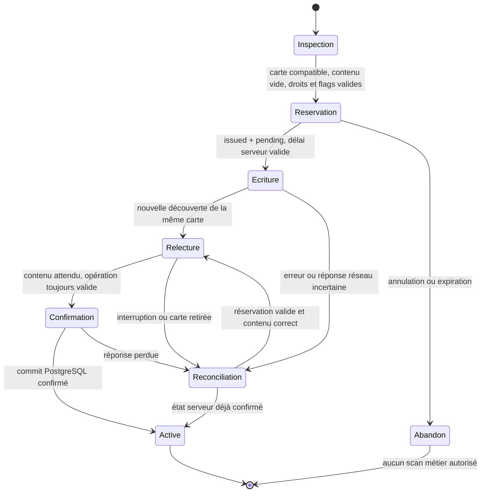

# NFC-PROG-01 — audit et contrat technique des cartes élèves

**Décision autorisée : audit documentaire uniquement. Option C : individuel et série.**

**DRAFT / HOLD — NO READY — NO MERGE — aucun déploiement.**

Audit du 13 octobre 2026. Cible : `develop`. Les contrats proposés ci-dessous
restent soumis à validation CTO ; aucun de ces changements n'est implémenté ici.
Le présent rapport ne débloque pas NFC-PROG-02 à NFC-PROG-05.

## 1. Conclusion et décisions nécessaires

Le socle existe. Il faut réutiliser `student_access_cards`, les flags
`school_settings`, le RBAC établissement et les services de cycle de vie.
La PR #909 contient déjà l'encodeur Android NTAG213/216, son panneau dans la fiche
élève, la relecture après une nouvelle découverte et le gestionnaire NFC partagé.
Elle contient également les travaux de #908 et la réconciliation du lecteur #891.
Ces trois PR sont toujours **non mergées** : ces composants ne sont pas disponibles
sur `develop` à la date de l'audit.

Le parcours individuel est partiel ; la programmation en série est absente.
Quatre points doivent être tranchés avant l'implémentation :

| Référence | Constat | Proposition soumise au CTO |
| --- | --- | --- |
| D1 — contenu NFC | Le format canonique contient un `publicId.secret`. Le secret est une capability de carte, même s'il n'est pas un identifiant de connexion utilisateur. Le mandat interdit les secrets d'authentification sur la puce. | Autoriser explicitement la capability de carte révocable, sans données personnelles ni secret de compte, pour préserver les lecteurs actuels. Si l'interdiction vise aussi cette capability, suspendre ce contrat de format et définir une évolution versionnée avec revue de sécurité et de compatibilité. |
| D2 — réservation | #909 réserve une ligne `status=active`, `nfc_encoding_state=pending`. Le scan la refuse, mais la carte occupe déjà l'unicité active ; aucune expiration n'existe. | Réservation non active, expiration serveur et activation seulement à la confirmation ; utiliser le statut existant `issued` et étendre le registre canonique de façon additive. |
| D3 — remplacement | Le remplacement PostgreSQL actuel est atomique, mais active immédiatement la nouvelle carte, sans UID NFC ni relecture préalable. | Préparer une nouvelle ligne non active ; garder l'ancienne utilisable jusqu'à une confirmation NFC qui bascule les deux lignes dans une seule transaction. |
| D4 — reprise et UID | L'UID reste réservé globalement, y compris après révocation. Le retry NFC actuel tourne le secret et peut écraser l'ancien NDEF du même `publicId` sans dialogue dédié. | Conserver l'historique et le refus inter-établissements. Reprendre une réservation valide après relecture ; exiger une confirmation explicite avant réécriture. Pas de recyclage implicite d'UID expiré ou révoqué. Décider séparément toute politique de réutilisation matérielle. |

Les migrations existantes ne portent ni délai d'expiration, ni intention de
remplacement NFC avant activation, ni clé durable d'opération. Une petite migration
additive est justifiée pour le contrat proposé en NFC-PROG-02, après validation.
Une nouvelle table de cartes, un module transport, une nouvelle logique de
présence ou une copie de données financières ne le sont pas.

## 2. Références GitHub vérifiées

Les états ont été relus via l'API REST GitHub, puis les références récupérées avec
`git fetch`. Les compteurs utilisent le `develop` courant, et non seulement le
champ `base.sha` retourné par l'API d'une ancienne PR.

| Référence | SHA complet | État | Ahead / behind par rapport à `develop` |
| --- | --- | --- | --- |
| `main` | `ef8bc9517ffc94aa770743713d0f561f92a9fc1e` | Référence vérifiée, aucune modification | — |
| `develop` | `1bdd302e8ab228d6aaf0bfea3078d9b8361efe1f` | Base de la PR documentaire | 0 / 0 |
| [#891](https://github.com/Somafrik-education/Somafrik/pull/891) | `b2aaa6151468b9398b1644299f4bdc081ccb050c` | Open, Draft, non mergée | 6 / 14 |
| [#908](https://github.com/Somafrik-education/Somafrik/pull/908) | `c3db71cbaa6e77e761576d439562336c4d6791e6` | Open, Draft, non mergée | 5 / 0 |
| [#909](https://github.com/Somafrik-education/Somafrik/pull/909) | `91c2af5c5a6255f010fbbbf7f3b5f85a5d04cb22` | Open, Draft, non mergée | 6 / 0 |

Merge-base #891 / `develop` : `72aea41b15f234afc867530f6728a3a239d1914f`.
Merge-base #908 et #909 / `develop` :
`1bdd302e8ab228d6aaf0bfea3078d9b8361efe1f`.

La PR documentaire part directement du `develop` vérifié, dans une branche dédiée.
Elle n'embarque aucun commit des PR non mergées. Son HEAD et ses compteurs définitifs
figurent dans la description GitHub, afin de ne pas écrire un SHA autoréférentiel
dans son propre commit.

### CARTE-PR0 et dépendances déjà intégrées

Les vieux documents d'AUDIT-CARTE-01 indiquent encore « CARTE-PR0 non ouverte ».
Cette mention est historique : l'API et les commits prouvent l'intégration suivante
dans `develop`. Aucun de ces merges n'a été effectué pendant cet audit.

| PR | Apport réutilisable | Commit de merge |
| --- | --- | --- |
| [#877](https://github.com/Somafrik-education/Somafrik/pull/877) — CARTE-PR0 | Flags établissement, défauts false | `8bbeb9a9d9361e6785365b6cadde01f815afa1af` |
| [#879](https://github.com/Somafrik-education/Somafrik/pull/879) — PR1 | Registre PostgreSQL | `6f89bf13d3ee7337ea72d3d91a5af26a30c0a22a` |
| [#880](https://github.com/Somafrik-education/Somafrik/pull/880) — PR2 | Émission, liste, perte, révocation, remplacement | `3731b0ab8181ca66f52412d15a0fa2e6ea052269` |
| [#881](https://github.com/Somafrik-education/Somafrik/pull/881) — PR3 | Résolution du token | `51a55dd251de3a1a5f5d0321dc16f09386e094ef` |
| [#882](https://github.com/Somafrik-education/Somafrik/pull/882) — PR4 | Présence canonique | `ceed530fc791c11129dcd39e4d2f8044bff6cb20` |
| [#884](https://github.com/Somafrik-education/Somafrik/pull/884) — PR5 | Finance informative et permission distincte | `84c9084f5a1f27b0f0f34dc89c974ad49fa43535` |
| [#885](https://github.com/Somafrik-education/Somafrik/pull/885) | Exclusion du token des données d'idempotence | `510f2272f4d3558051f197b4177376a42ad5e9a9` |
| [#886](https://github.com/Somafrik-education/Somafrik/pull/886) — PR6 | Gestion et impression web | `37dbfc676869c9d91e583cb05987e1e908894faa` |
| [#889](https://github.com/Somafrik-education/Somafrik/pull/889) — PR7 | Lecteur QR Mobile | `ed16f3b3bf5be8de4a001ea9e29dd9029b80ff0c` |
| [#890](https://github.com/Somafrik-education/Somafrik/pull/890) | Gate NFC Stores | `72aea41b15f234afc867530f6728a3a239d1914f` |

Les contrôles d'ascendance Git accompagnent la vérification API. L'audit distingue
ainsi une fonctionnalité intégrée d'une fonctionnalité seulement présente en Draft.

## 3. Code réel et réutilisation

Les liens de la colonne source sont fixés au SHA audité #909. La présence d'un
composant dans #909 n'est pas une autorisation de l'intégrer.

| Composant | Sur `develop` | Complément #909 et limites | Source vérifiable |
| --- | --- | --- | --- |
| Registre carte | Table, FK tenant, unicités, historique | Colonnes NFC et unicité UID historique globale | [Migration canonique](https://github.com/Somafrik-education/Somafrik/blob/91c2af5c5a6255f010fbbbf7f3b5f85a5d04cb22/backend/db/migrations/20261006_student_access_cards.sql), [extension NFC](https://github.com/Somafrik-education/Somafrik/blob/91c2af5c5a6255f010fbbbf7f3b5f85a5d04cb22/backend/db/migrations/20261012_student_cards_nfc_encoding.sql) |
| Émission / cycle de vie | Oui | Émission NFC = active + pending, sans TTL | [Services](https://github.com/Somafrik-education/Somafrik/blob/91c2af5c5a6255f010fbbbf7f3b5f85a5d04cb22/backend/lib/studentAccessCardsManagement.js#L246) |
| Confirmation et retry NFC | Non | Confirmation avec token + UID + modèle ; rotation conditionnelle du secret pending | [Service NFC](https://github.com/Somafrik-education/Somafrik/blob/91c2af5c5a6255f010fbbbf7f3b5f85a5d04cb22/backend/lib/studentCardsNfcEncoding.js#L34) |
| SQL de confirmation | Non | UPDATE conditionnel ; confirmation répétable mais audit répété | [Store](https://github.com/Somafrik-education/Somafrik/blob/91c2af5c5a6255f010fbbbf7f3b5f85a5d04cb22/backend/db/studentAccessCardsPgStore.js#L299) |
| Encodeur Android | Non | UID NXP, GET_VERSION, NDEF, contrôle capacité, relecture fraîche | [Bridge natif](https://github.com/Somafrik-education/Somafrik/blob/91c2af5c5a6255f010fbbbf7f3b5f85a5d04cb22/Mobile/src/lib/studentCardNfcEncoderNative.ts) |
| Algorithmes d'encodage | Non | Encode, relecture/confirmation, retry ; contrôle données étrangères | [Orchestrateur existant](https://github.com/Somafrik-education/Somafrik/blob/91c2af5c5a6255f010fbbbf7f3b5f85a5d04cb22/Mobile/src/lib/studentCardNfcEncoding.ts) |
| Session NFC partagée | Non | Un propriétaire, fermeture attendue, reset conservant le propriétaire, refus des résultats tardifs | [Session pure](https://github.com/Somafrik-education/Somafrik/blob/91c2af5c5a6255f010fbbbf7f3b5f85a5d04cb22/Mobile/src/lib/nfcSession.ts), [singleton natif](https://github.com/Somafrik-education/Somafrik/blob/91c2af5c5a6255f010fbbbf7f3b5f85a5d04cb22/Mobile/src/lib/nfcSessionNative.ts) |
| Fiche élève | Fiche et navigation existantes | Panneau d'encodage branché ; aucune action de remplacement NFC préparé | [Fiche](https://github.com/Somafrik-education/Somafrik/blob/91c2af5c5a6255f010fbbbf7f3b5f85a5d04cb22/Mobile/src/screens/StudentDetailScreen.tsx#L510), [panneau](https://github.com/Somafrik-education/Somafrik/blob/91c2af5c5a6255f010fbbbf7f3b5f85a5d04cb22/Mobile/src/components/StudentCardNfcEnrollmentPanel.tsx) |
| Série depuis classe | Non | Aucun écran, file, sélection, compteur, reprise ou bilan | [Classes existantes](https://github.com/Somafrik-education/Somafrik/blob/91c2af5c5a6255f010fbbbf7f3b5f85a5d04cb22/Mobile/src/screens/ClassesScreen.tsx) |
| Lecteurs QR / NFC | QR intégré | Lecteur NFC reconcilié de #891, même token canonique | [Lecture NFC](https://github.com/Somafrik-education/Somafrik/blob/91c2af5c5a6255f010fbbbf7f3b5f85a5d04cb22/Mobile/src/lib/studentCardNfc.ts), [scan](https://github.com/Somafrik-education/Somafrik/blob/91c2af5c5a6255f010fbbbf7f3b5f85a5d04cb22/Mobile/src/lib/studentCardScan.ts) |

### Parcours individuel observé

`Classes → Students → StudentDetail → Carte élève NFC` existe dans #909.
Le panneau lit l'UID, propose « Encoder et affecter », réserve côté serveur,
écrit, relit et confirme. Il affiche le statut et permet une reprise pending.
Le token reste dans une ref volatile, sans affichage ni persistance.
Le contexte identité/classe/établissement appartient à la fiche ; le panneau ne
présente pas encore une confirmation complète du contexte ni le libellé demandé
« Carte NFC programmée et associée avec succès. »

La lecture du contenu NDEF intervient **après** `api.issue` dans le parcours courant.
Une carte étrangère peut donc provoquer une réservation pending puis être refusée
sans écriture. Le nouveau contrat doit inspecter l'état avant de réserver, puis
le revérifier immédiatement avant l'écriture. Le contrôle UID reste nécessaire
entre les découvertes ; il ne prouve pas l'authenticité d'une puce.

Le panneau bloque les doubles actions et invalide les opérations en arrière-plan
ou quand les droits changent. Une requête HTTP déjà envoyée peut toutefois réussir
après la fermeture de l'écran. La génération UI n'annule pas une transaction serveur :
la reprise doit relire l'état PostgreSQL avant de réémettre une mutation.

### Limites précises

- Aucun TTL, cleanup des réservations, endpoint d'abandon dédié ou clé d'opération NFC.
- L'émission HTTP perdue après commit n'est pas rejouée idempotemment : une nouvelle
  émission peut répondre « carte active existante » ; la liste permet de retrouver
  la ligne, mais ne restitue pas le secret.
- Le retry NFC tourne le secret d'une carte pending. Il n'est pas un replay identique
  d'une demande et doit rester distinct d'une relecture de récupération.
- La confirmation ne constitue pas une attestation matérielle : le client rapporte
  la relecture, le serveur vérifie le token, le tenant et l'affectation.
- L'UPDATE de confirmation/rotation et l'audit sont séparés. Une erreur d'audit peut
  être retournée après la modification de l'état ; un retry peut produire un second audit.
- Le remplacement existant ne renseigne pas les métadonnées NFC de la nouvelle carte.
  Il ne satisfait donc pas le remplacement « écrire / relire / basculer » du mandat.
- Une carte active QR existante ne peut pas recevoir silencieusement une nouvelle
  association NFC. Le contrat propose un remplacement explicite, y compris pour QR,
  avec avertissement de l'invalidation de l'ancien QR à la confirmation.
- Aucune prise en charge de formatage NdefFormatable brut : une puce sans NDEF
  compatible est refusée. Un NTAG216 vierge avec NDEF d'usine vide est accepté
  logiciellement ; ce point doit être vérifié sur le lot physique disponible.
- Le verrouillage irréversible existe dans #909 comme action explicite distincte.
  Il n'entre pas dans les parcours NFC-PROG, ni dans leur smoke ; son retrait ou
  son masquage dans ces parcours devra être réalisé et relu en NFC-PROG-03.

## 4. Format NDEF et décision D1

Format actuel : **un seul record NDEF Text**, langue `en`, valeur
`somafrik:card:<publicId>.<secret>`. Aucun token réel n'est reproduit ici.

`publicId` : 16 octets aléatoires, base64url de 22 caractères.
`secret` : 32 octets aléatoires, base64url de 43 caractères.
La génération utilise `crypto.randomBytes` côté serveur ; PostgreSQL conserve
le SHA-256 du secret. La résolution vérifie ce hash en temps constant et exige
le rôle, le tenant, le statut et les permissions métier de l'opérateur.

Le texte compte 80 octets ASCII, le record NDEF 87 octets et le TLV 90 octets,
dans les capacités NTAG213 (144 octets) et NTAG216 (888 octets).
Le codec réel de `react-native-nfc-manager@4.0.0-beta.10` est couvert par le test
de session partagé, et pas seulement par une formule de taille.

**Le format actuel n'a pas de champ explicite de version.** Il existe déjà et les
lecteurs le reconnaissent : la clause « proposer un format si aucun n'existe »
ne justifie pas de créer un autre format dans ce chantier documentaire.

Il n'y a aucune identité, classe, donnée de présence ou de finance sur la carte.
Cependant le secret de carte **est bien un secret porteur révocable** : un lecteur
peut le copier. Le qualifier seulement de « référence opaque sans secret » serait
inexact. Il ne permet pas à lui seul de se connecter à Somafrik et ne remplace
jamais les permissions de l'opérateur, mais c'est une capability utilisée pour
valider le contenu présenté au serveur.

**Recommandation conditionnelle :** réutiliser ce format si le CTO accepte
explicitement cette catégorie limitée de secret. Si l'interdiction est absolue,
un identifiant opaque sans secret ne peut pas être substitué unilatéralement :
la résolution backend et les lecteurs QR/NFC devraient évoluer, avec une décision
de sécurité contre l'énumération et le clonage. Cet autre contrat nécessiterait
un mandat élargi. Aucune de ces options n'est considérée approuvée par cet audit.

GET_VERSION vérifie les huit octets attendus ; le type 0x0f correspond à NTAG213,
0x13 à NTAG216, avec UID NXP de sept octets commençant par 04.
Cela vérifie une compatibilité logicielle, sans attestation anti-clonage.
Le matériel physique déclaré disponible est **NTAG216 seulement**.

## 5. Backend, PostgreSQL, RBAC et feature flags

### Autorité canonique existante

`student_access_cards` contient l'identifiant public, le hash, l'élève,
l'établissement, le support, le statut, les dates, l'auteur, la révocation et
`replaced_by_card_id`. Les contraintes garantissent :

- unicité de `public_id` et de `token_hash` ;
- au plus une carte `active` par `(school_id, student_id)` ;
- FK composite de l'élève dans son établissement ;
- remplacement vers une carte du même élève et du même établissement ;
- cohérence des états et dates de cycle de vie ;
- dans #909, cohérence UID/modèle/NDEF et unicité historique globale de l'UID.

Le backend refuse le moteur mémoire pour les routes cartes : PostgreSQL requis.
Le scan refuse les cartes lost, revoked, replaced, issued et active/pending.
Une réservation pending actuelle ne peut donc pas pointer une présence, mais
son étiquette `active` ne respecte pas la séparation demandée par le nouveau mandat.

### Routes réutilisables

| Route actuelle | Permission canonique | Évolution envisagée |
| --- | --- | --- |
| `GET /api/students/:id/cards` | `Élèves:READ` / `Voir élèves` | Réconciliation des opérations et état expiré, sans secret |
| `POST /api/student-cards` | `Élèves:UPDATE` / `Gérer élèves` | Réservation NFC non active ; préserver émission QR actuelle |
| `POST /api/student-cards/:id/nfc-confirm` | Même UPDATE | Activation transactionnelle et résultat idempotent |
| `POST /api/student-cards/:id/nfc-retry` | Même UPDATE | Rotation explicite seulement ; ne pas confondre avec relecture |
| `POST /api/student-cards/:id/replace` | Même UPDATE | Préparation NFC explicite sans bascule anticipée ; préserver comportement QR existant |
| `POST /api/student-cards/:id/lost` et `/revoke` | Même UPDATE | Réutiliser les transitions canoniques ; aucune réactivation |
| `POST /api/student-cards/scan` | `Présences:CREATE` / `Présences:UPDATE` | Aucun changement métier dans NFC-PROG |

Les alias sont ceux du RBAC existant, pas des droits créés pour tous les utilisateurs
authentifiés. Les routes #909 passent par `requireAuth`, `requirePermission`,
`enrollmentHttpPrincipal` et `studentCardsHttpScope` ; le scope doit être école
avec membership et `login_code` canonique.
Le [guard plateforme](https://github.com/Somafrik-education/Somafrik/blob/91c2af5c5a6255f010fbbbf7f3b5f85a5d04cb22/backend/lib/platformPersonalDataGuard.js#L94)
interdit ces routes à SUPER_ADMIN / COUNTRY_ADMIN avant le test des privilèges.
L'UI ajoute READ + UPDATE pour le parcours, sans se substituer au backend.

Toute route nouvelle, notamment abandon ou projection d'éligibilité de classe,
devra être ajoutée aux guards plateforme et mappings RBAC ; aucun accès implicite
ni fallback ALL_PRIVILEGES ne doit contourner le refus plateforme.
La sélection de classe doit utiliser l'autorisation canonique de la classe et
la liste de ses élèves, pas un filtre de nom de classe envoyé par le client.
Ne pas élargir le périmètre de lecture des enseignants ou d'autres rôles restreints.

Flags requis pour toutes les mutations NFC : `student_card_enabled === true`
**et** `student_card_nfc_enabled === true`. `coerceFailClosedBoolean` accepte
seulement le booléen true ; absent, null, chaîne « true », invalide et false refusent.
Chaque mutation doit revérifier les flags et droits, y compris après un changement
pendant une programmation. Le mode série réutilise les mêmes flags ; les flags
attendance/finance ne sont pas nécessaires à la programmation et ne sont pas forcés.

## 6. Contrat de réservation proposé — non implémenté

### Machine d'état commune aux deux modes



« Succès » signifie réponse positive serveur pour l'opération attendue et état
active/encoded confirmé, jamais simple retour positif de `writeNdefMessage`.
Une réponse incertaine affiche « Confirmation à vérifier » ; elle n'est ni une
réussite comptée ni un motif pour changer silencieusement d'élève.

1. Charger la fiche et la classe depuis les sources canoniques ; vérifier READ,
   UPDATE, tenant, flags et connectivité avant de proposer l'action.
2. Après action explicite, inspecter NTAG216/213, UID, NDEF et inscriptibilité.
   Refuser un contenu étranger sans effacement ni fuite d'identité d'un autre tenant.
3. Réserver dans PostgreSQL avec une clé d'opération aléatoire et un délai serveur.
   Créer une ligne `issued/pending`, donc non active et non scannable. Le serveur
   génère le token, sous réserve de D1. La carte physique peut être présentée avant
   la réservation, mais aucune écriture n'a lieu avant sa création.
4. Revérifier UID, état et contexte ; écrire via l'encodeur existant. Une carte
   inconnue ou associée ailleurs est toujours refusée, même avec un dialogue.
5. Faire une nouvelle découverte, vérifier même UID/modèle et contenu exact.
   La donnée NDEF issue du cache Android n'est pas une preuve de relecture.
6. Confirmer côté serveur : droits, flags, tenant, délai, token et intention ;
   mutation et audit cohérents dans une transaction. Publier seulement après commit.
7. En cas de fermeture/interruption, terminer la session native et réconcilier
   la ligne serveur à la reprise. Ne pas garder le secret dans la file persistante.

L'ordre « préparer identifiant puis présenter carte » du mandat peut être exposé
comme intention UI. La réservation liée à un UID est créée après inspection, ce
qui réutilise #909 et évite de brûler une affectation pour une carte inconnue.

### Migration additive réellement nécessaire

Conserver les états existants ; utiliser `issued` pour la réservation NFC au lieu
d'inventer un registre parallèle. Ajouter au registre, avec noms définitifs à
fixer en NFC-PROG-02 : date d'expiration de réservation, clé d'opération et
référence de la carte à remplacer. Prévoir :

- unicité de la clé d'opération dans l'établissement et contrôle de ses paramètres
  (élève, UID, modèle, intention, auteur/périmètre) ;
- au plus une réservation NFC ouverte par élève, y compris lorsqu'une ancienne
  carte active reste utilisable pour un remplacement ;
- FK composite de la carte à remplacer vers le même élève / tenant ;
- CHECK des champs de réservation selon les états ;
- expiration explicite vers un état révoqué avec raison et audit, sans activation.

Une contrainte d'unicité partielle ne doit pas dépendre de `NOW()` : un index ne
nettoie pas les lignes quand le temps avance. La transaction retire d'abord les
réservations expirées sous verrou, puis réserve ; une tâche canonique peut traiter
les abandons, mais le refus à confirmation ne dépend jamais de sa ponctualité.
La durée exacte reste une décision de configuration serveur, pas un temps local
Android. Aucun DDL request-time ; migration revue et exécutée par le mécanisme existant.

Conserver l'unicité active et UID historique. Une réservation expirée ne peut pas
être réanimée ; une carte déjà écrite mais expirée est inutilisable en scan.
Un recyclage de cette même puce nécessiterait un contrat CTO distinct, une action
autorisée explicite et un historique préservé. Le présent contrat accepte ce coût
matériel plutôt qu'une réutilisation silencieuse inter-élèves/inter-établissements.

### Transactions, concurrence et idempotence

Verrouiller l'élève canonique, puis les cartes impliquées dans un ordre déterministe.
Deux appareils ne peuvent pas ouvrir deux réservations pour le même élève ; deux
élèves ne peuvent pas réserver le même UID. Les contraintes PostgreSQL sont le
dernier rempart, avec retour 409 contrôlé et sans révélation du tenant propriétaire.

Ne pas mettre une réponse contenant `cardToken` dans le cache générique
d'idempotence : cela contredirait SEC-CARD-IDEM-01. Un replay de réservation
retrouve son identifiant et son état sans restituer de secret stocké en clair.
Si la première réponse est perdue avant écriture, une rotation contrôlée du secret
pending est nécessaire ; si la puce a été écrite, lire son token et confirmer
avant de proposer une rotation.

La confirmation repetée doit renvoyer l'état déjà confirmé pour la même opération,
sans double association, sans seconde bascule et sans second audit de transition.
Une même clé avec paramètres divergents est refusée. Une rotation et une
confirmation concurrentes ne peuvent pas accepter un secret devenu obsolète.
Conserver les guards hash conditionnels existants et les adapter aux états proposés.

L'abandon, l'expiration, la perte ou la révocation ne réactivent jamais une ligne.
Les refus et replays doivent fonctionner même si l'UI a été interrompue après un
commit serveur. En cas d'échec de l'audit transactionnel, la mutation est rollbackée.

### Remplacement NFC

Préparer avec l'identifiant explicite de l'ancienne carte ; aucune sélection
automatique ambiguë. L'ancienne carte active reste utilisable pendant
inspection/écriture/relecture. À confirmation, dans une seule transaction :
vérifier l'ancienne référence et son état attendu, la marquer `replaced` avec le
lien historique, puis activer la nouvelle carte vérifiée. Le rollback conserve
l'ancienne association si la bascule échoue. Une ancienne carte déjà `lost`
reste refusée pendant la préparation ; elle n'est jamais réactivée.

L'endpoint existant de remplacement immédiat QR conserve son contrat actuel.
Son extension NFC doit être explicite, avec tests de non-régression QR et avertissement
si le remplacement invalide un QR imprimé. Aucun simple appel au remplacement
actuel ne doit servir de préparation NFC.

## 7. Contrat Android individuel et série — non implémenté

### Un seul moteur d'opération

Réutiliser `studentCardNfcEncoding.ts`, `studentCardNfcEncoderNative.ts`,
`studentCardEnrollmentApi.ts` et `nfcSessionNative.ts` après intégration autorisée
de #909. Adapter leurs états / réponses au contrat backend validé.
Le mode série orchestre ce moteur pour un élève à la fois ; il ne crée ni second
manager, ni second encodeur, ni endpoint de scan de présence.

États UI communs : prêt, inspection, réservation, écriture, relecture,
confirmation, confirmé, erreur, confirmation incertaine, pause/abandon.
Un verrou d'opération doit rester détenu jusqu'au règlement des appels natifs et
de la confirmation en cours. Double appui et double présentation ne créent aucune
deuxième demande. Les permissions/flags rafraîchis invalident toute suite d'opération.

La fermeture, le changement d'élève/établissement et l'arrière-plan invalident
les callbacks tardifs et ferment seulement la session possédée. Une annulation
native échouée maintient le gestionnaire partagé en refus de nouvelles acquisitions
jusqu'à récupération ; aucun fallback à deux lecteurs concurrents.

Avant toute réécriture de données reconnues appartenant à cette même opération,
présenter une confirmation explicite, par exemple « Réécrire cette réservation ? ».
Cette confirmation ne permet jamais d'effacer une carte inconnue ou d'un autre élève.
Le chemin par défaut reprend d'abord une relecture/confirmation du token actuel,
et non une rotation automatique. Aucun bouton de verrouillage irréversible dans
les deux parcours de programmation du mandat.

### Mode A — individuel

Depuis la fiche, afficher identité, classe canonique, établissement et état des
cartes. Proposer « Programmer une carte » seulement sans carte active ni réservation
à réconcilier ; proposer « Remplacer une carte » seulement par action explicite
autorisée. La carte perdue se traite via la route canonique de perte/révocation.
Un succès confirmé affiche exactement :

> Carte NFC programmée et associée avec succès.

Une erreur de carte retirée, incompatible, verrouillée ou déjà liée reste sur le
même élève, avec retry adapté à la phase et sans fausse confirmation.

### Mode B — série depuis une classe

La navigation actuelle Classes → Students passe un `className`. Le nouveau point
d'entrée Cartes NFC / Programmation en série doit transporter l'identifiant
canonique de classe et résoudre sa liste autorisée ; le nom est une étiquette,
pas l'autorité de sélection. Réutiliser les projections/scope existants.

Sélection : tous sans carte active, plusieurs ou un seul. Une réservation pending
doit être signalée comme « à reprendre » ; elle ne fait pas partie des cartes vierges
à programmer silencieusement. Des élèves avec carte active peuvent être visibles
mais ne sont pas éligibles à la création ; leur remplacement reste un parcours
individuel explicite dans cette première version.

File ordonnée d'identifiants d'élèves, sans tokens. L'élève courant est affiché
avant toute écriture. Après confirmation serveur et fermeture native terminées,
l'application montre le succès puis avance automatiquement au prochain élève.
Une présentation fraîche est requise pour le suivant ; conserver l'UID de la
dernière carte uniquement en mémoire pour refuser sa présentation immédiate.
L'unicité serveur reste obligatoire même si l'application redémarre.

Compteurs proposés, sans ambiguïté :

- sélectionnés = taille initiale de la file ;
- programmés = confirmations serveur uniques dans cette session ;
- ignorés = élèves explicitement différés ;
- restants = sélectionnés − programmés − ignorés, incluant l'élève courant en erreur ;
- échecs = nombre d'élèves avec une erreur non résolue, pas le nombre d'appuis retry.

Un retry réussi retire l'erreur courante. Le bilan conserve le nombre de tentatives
échouées séparément si nécessaire. Une carte déjà confirmée avant reprise apparaît
comme « déjà associée », sans être comptée une deuxième fois comme nouvellement
programmée. Ne pas inventer un total historique de session après perte de sa file.

En cas d'erreur, rester sur l'élève ; proposer Réessayer, Ignorer temporairement,
Interrompre. Ignorer après réservation nécessite abandon ou conservation explicite
« à reprendre » ; aucune libération implicite du token. Les associations confirmées
restent dans PostgreSQL. Une interruption pendant une confirmation incertaine
nécessite réconciliation avant de l'ignorer ou de l'émettre à nouveau.

### Reprise sans nouvelle table de cartes ni journal de secrets

Pour ce premier contrat, la reprise après fermeture recharge la classe autorisée
et les états cartes depuis le backend : les cartes confirmées sont exclues de la
nouvelle file de création, les réservations valides proposées à la reprise.
La file et ses compteurs en mémoire peuvent être perdus ; les associations ne le sont pas.
Un abandon explicite de session n'annule pas les cartes déjà confirmées.

Si le produit exige la même sélection, le même ordre et le même bilan après arrêt
du processus, il faut valider une persistance supplémentaire d'identifiants et
compteurs, scoped utilisateur/tenant, dans l'infrastructure Mobile existante.
Ce besoin ne doit pas être déclaré résolu par la seule mémoire JS. Aucun secret,
NDEF complet ou donnée financière ne doit être persisté pour cette reprise.
Un registre serveur parallèle ou une nouvelle table de batch n'est pas nécessaire
pour garantir l'absence de doubles associations.

## 8. Compatibilité avec les usages existants

| Usage | Résultat de l'audit | Limite et non-régression requise |
| --- | --- | --- |
| Présence | Le scan canonique résout l'élève et peut écrire la présence immédiatement via les services existants. | Pas de nouvelle session métier de collecte/revue dans NFC-PROG. Une éventuelle évolution vers présence par session reste un chantier distinct. |
| Impayés | Les frais/paiements canoniques produisent un badge informatif avec flag finance et permissions séparées. | Ni montants sur la puce, ni exclusion automatique fondée sur une dette, ni élargissement des droits finance. |
| Transport | Aucun module canonique d'embarquement/transport NFC trouvé dans le périmètre backend/navigation audité. Un type de frais TRANSPORT ne constitue pas un module bus. | Le même identifiant pourra être résolu par un futur module autorisé ; aucune validation d'usage transport de bout en bout n'est possible aujourd'hui. |
| QR | Lecteur de secours et émission/impression existants. | Conserver le format et les règles de résolution sous réserve de D1 ; tester les cartes QR historiques et l'effet explicite d'un remplacement. |

## 9. Preuves et tests rejoués pendant l'audit

Sources testées : #909 exact `91c2af5c5a6255f010fbbbf7f3b5f85a5d04cb22`, arbre
source propre avant et après exécution. Aucun test ou fichier d'implémentation
n'a été ajouté au dépôt par cette PR documentaire.
Node 22.23.3, PostgreSQL local jetable 16.15 ; aucun accès à une base applicative.

| Vérification rejouée | Résultat | Ce qu'elle prouve |
| --- | --- | --- |
| 7 suites backend unitaires ciblées | 53 tests, 53 PASS, 0 FAIL, 0 SKIP | Cycle de vie, capabilities, flags, présence/finance, NFC et refus RBAC existants |
| `studentCardsNfcEncoding.sql.test.js` | 1 test réel PostgreSQL PASS, 0 SKIP | CHECK NFC, UID unique, tenant, hash stale, lock monotone, QR compatible |
| 7 runners PostgreSQL cartes | Tous PASS, aucun SKIP | Registre, lifecycle, resolve, attendance, finance, HTTP et scan HTTP ; concurrence d'émission et rollback du remplacement existant |
| `verify:student-card-qr` | PASS | QR/NFC, 10 tests du gestionnaire partagé et guards Mobile |
| `test:student-card-nfc-encoding` | 13 PASS, 0 FAIL, 0 SKIP | NTAG213/216, données étrangères, relecture, retry, refus et autorisations Mobile |
| Probes d'audit externes sur schéma PG rollbacké | Trois observations reproduites | Absence de TTL ; audit répété en retry ; erreur audit après UPDATE déjà effectif |
| CI #909 relue via REST au SHA exact | 42 derniers check-runs SUCCESS | État CI de la dépendance #909, pas validation des nouveaux parcours proposés |

Les probes, exécutées hors dépôt, créent uniquement un schéma transactionnel jetable,
insèrent une carte NTAG216 synthetic active/pending et utilisent les services réels :

1. Dater `issued_at`, `created_at`, `updated_at` à 2000 ; confirmer avec le token
   généré en mémoire. Résultat : encoded. Le service ne vérifie aucun délai.
2. Confirmer une seconde fois avec le même token. Résultat : une association mais
   deux appels d'audit. Idempotence de la transition d'audit non garantie.
3. Revenir en pending dans le schéma de test ; injecter un rejet `recordAudit`.
   Résultat : le service rejette mais la ligne est déjà encoded. La transaction
   du probe est finalement rollbackée ; aucune ligne de test n'est conservée.

### Commandes reproductibles sur #909

Les runners historiques ci-dessous créent des bases dédiées et certains effacent
leur schéma public. Les exécuter **uniquement sur un PostgreSQL jetable isolé**.
La variable `DATABASE_URL` doit être remplacée par celle de ce conteneur, jamais
héritée d'une configuration de production. La suite NFC utilise exclusivement
`SOMAFRIK_NFC_TEST_DATABASE_URL`.

```bash
node --test backend/lib/studentAccessCardsManagement.test.js \
  backend/lib/studentCardCapability.test.js \
  backend/lib/studentCardCapabilities.test.js \
  backend/lib/schoolSettings.studentCard.test.js \
  backend/lib/studentCardAttendance.test.js \
  backend/lib/studentCardFinance.test.js \
  backend/lib/studentCardsNfcEncoding.test.js
node --test backend/lib/studentCardsNfcEncoding.sql.test.js
node backend/lib/studentAccessCards.pg.test.js
node backend/lib/studentAccessCards.lifecycle.pg.test.js
node backend/lib/studentAccessCards.resolve.pg.test.js
node backend/lib/studentAccessCards.attendance.pg.test.js
node backend/lib/studentAccessCards.finance.pg.test.js
node backend/lib/studentAccessCards.http.pg.test.js
node backend/lib/studentAccessCards.scan.http.pg.test.js
npm --prefix Mobile run verify:student-card-qr
npm --prefix Mobile run test:student-card-nfc-encoding
```

Ces tests ne couvrent pas encore expiration, réservation non active, remplacement
NFC différé ou compteurs/reprise du mode série : ces fonctionnalités sont absentes.
Les PASS existants ne valent donc pas validation de NFC-PROG-02/03/04.
Une première invocation Mobile a échoué sur le cache npm hors workspace et un nom
de script erroné ; le cache workspace et le script déclaré ont été utilisés au
rejeu. Les résultats ci-dessus sont ceux des commandes corrigées, sans assertions modifiées.

### APK et CI de la dépendance

La CI #909 a compilé un APK ARM64 de preview et l'a vérifié dans le
[run 38368481589](https://github.com/Somafrik-education/Somafrik/actions/runs/38368481589).
Artifact : `nfc-preview-91c2af5c5a6255f010fbbbf7f3b5f85a5d04cb22`, ID `11797769986`.
Digest **de l'archive artifact GitHub**, pas du fichier APK :
`sha256:311f039702c7e2fceeef94115254baae9d114058994c37869fd9db7b52b347a1`.
Cet APK ne contient pas les évolutions proposées dans cet audit.
Il n'a pas été installé ni testé physiquement par Codex. La PR documentaire
ne doit pas déclencher une fausse preuve d'APK du nouveau produit.

## 10. Matrice de validation des PR futures

| Lot | Cas obligatoires avant revue |
| --- | --- |
| Backend / PG | Réservation valide non active ; carte déjà liée ; élève actif existant ; mauvais tenant ; READ seul et UPDATE absent ; refus Superadmin/Admin Pays même ALL_PRIVILEGES ; flags false/absent/null/invalide ; expiration avant écriture et après écriture ; abandon ; aucun scan pending/expired/revoked ; confirmation avec secret/hash obsolète ; réponse perdue ; replay même clé / paramètres divergents ; audit rollback ; remplacement avec ancienne active ou lost ; aucune réactivation ; QR historique. |
| Concurrence PG réelle | Deux créations même élève ; deux élèves même UID ; deux réservations de remplacement ; deux confirmations même opération ; confirm vs rotation ; confirm vs abandon/expiration ; confirm vs perte/révocation de l'ancienne ; deux remplacements de la même carte. Vérifier une seule active, lien historique et nombre d'audits. |
| Android automatisé | Détection GET_VERSION NTAG216/213 ; NDEF vide, texte étranger, record multiple, carte non NDEF, readonly, capacité ; carte retirée et erreur d'écriture ; relecture fraîche ; mauvais UID à relecture ; double appui/présentation ; deux façades concurrentes ; arrière-plan/unmount/changement élève ou tenant ; flags/droits retirés ; confirmation HTTP perdue et réconciliation ; aucune écriture inconnue ni lock. |
| Mode individuel | Contexte affiché ; programmer ; reprendre ; remplacer explicite ; perdre/révoquer ; erreur sans succès ; succès seulement après commit ; ancien QR invalidé seulement à bascule explicite. |
| Mode série | Sélection tous sans active / plusieurs / un ; identifiant classe canonique ; queue dédupliquée ; compteurs ; avance seulement après confirmation ; erreur reste sur élève ; retry ; ignorer ; interrompre ; bilan ; reprise après kill et association existante ; dernier UID refusé ; aucun secret persisté. |
| Régressions | Présence manuelle et scan existants ; finance informative et permissions ; QR ; feature flags off ; tenant ; APK NFC optional ; téléphone sans NFC ; aucune permission/entitlement iOS NFC ajouté. |

## 11. Smoke physique NTAG216 — protocole, pas résultat

**Statut : NOT_RUN.** Le mandat déclare des cartes NTAG216 disponibles, mais aucun
téléphone/carte physique n'est accessible à Codex dans cet environnement cloud.
Nombre de cartes réellement utilisées par Codex : **0**. Aucun PASS physique
NTAG216 ou NTAG213 n'est annoncé.

À exécuter sur un APK du SHA des parcours implémentés, après autorisation et sur
un établissement de recette. Proposer dix NTAG216 vierges distinctes si le lot le
permet ; enregistrer le nombre réel. Ne jamais faire de test d'affectation sur
un établissement ou des élèves de production.

| Preuve à renseigner | Valeur avant exécution |
| --- | --- |
| Version APK / versionCode, artifact, SHA-256 du fichier APK | À renseigner |
| Git HEAD exact, base, profil et API de recette | À renseigner |
| Modèle téléphone / Android / état NFC | À renseigner |
| Lot et nombre de NTAG216 utilisées | À renseigner ; 0 testée par Codex |
| Paramètres établissement et rôle/permissions de recette | À renseigner sans secret |
| Cas, résultat, anomalies, opérateur et horodatage | À renseigner par test |

Séquence proposée :

1. Vérifier NFC off puis on ; refus sans UPDATE et avec master/NFC désactivés.
2. Carte 1 : programmation individuelle, relecture physique fraîche, confirmation
   serveur, résolution dans les lecteurs existants avec opérateur autorisé.
3. Représenter carte 1 pour un autre élève : refus explicite sans écriture ni identité
   d'un autre établissement. Test tenant croisé en recette si disponible.
4. Carte 2 : retirer pendant écriture ; erreur sans succès, puis reprise sûre.
5. Carte 3 : interrompre entre écriture et confirmation ; reprise par relecture,
   sans rotation non confirmée ni seconde association.
6. Carte 4 : remplacement explicite de carte 1 ; vérifier ancienne utilisable avant
   bascule, puis ancienne refusée et une seule active après commit. Tester l'échec
   de confirmation sans retrait anticipé de l'ancienne.
7. Cartes 5 à 9 : série de cinq élèves ; provoquer une erreur, réessayer, ignorer
   temporairement un élève et reprendre ; vérifier compteur, ordre et bilan.
8. Carte 10 : double présentation/appui et arrière-plan pendant session ; aucun
   double traitement ni lecteur concurrent. Révocation/perte et refus en scan.
9. Reprendre après arrêt du processus : classe rechargée, cartes confirmées
   conservées, aucune duplication. Tester une réservation expirée.

Contrôler l'absence de noms, classe, données financières et présence dans le NDEF.
La présence de la capability canonique dépend de la décision D1.
**Aucun verrouillage irréversible.** Une validation NTAG213 physique demandera un
lot NTAG213 réellement disponible et un rapport distinct ; compatibilité logicielle
et validation physique doivent rester séparées.
Le transport ne peut pas être validé en bout en bout sans module autorisé disponible.

## 12. Découpage et ordre d'intégration proposés

Les cinq PR restent distinctes, chacune en Draft avec branche dédiée et cible
`develop`. Des livrables séparés ne rendent pas leurs dépendances inexistantes.
Ne pas ouvrir une PR d'implémentation sans décision CTO sur ce rapport.

| Lot | Périmètre minimal | Dépendance / critère de départ |
| --- | --- | --- |
| NFC-PROG-01 | Ce rapport et ses preuves de revue | `develop` vérifié, aucun code produit |
| Dépendance #909 | Fournit encodeur, lecteur réconcilié, singleton et extension NFC existants | Diff CTO indépendant et décision d'intégration #909 ; ne pas remerger séparément les mêmes changements #891/#908 |
| NFC-PROG-02 | Adapter réservation/confirmation/abandon/expiration et remplacement NFC ; migration additive ciblée ; audit transactionnel ; concurrence PostgreSQL ; projection d'éligibilité de classe seulement si nécessaire | Audit validé, D1–D4 tranchées, composants backend #909 sur base d'intégration vérifiée |
| NFC-PROG-03 | Adapter le panneau et moteur existants au contrat backend ; parcours individuel et remplacement ; refus d'écrasement ; masquage lock dans ce parcours ; tests Android | #909 et contrat #02 intégrés ou ordre de dépendance explicitement approuvé par CTO |
| NFC-PROG-04 | Nouveau parcours classe/file/compteurs/erreurs/reprise/bilan autour du moteur #03 ; pas d'encodeur parallèle | Moteur individuel et API validés ; sémantique de reprise et compteurs acceptée |
| NFC-PROG-05 | Intégration/régression, APK du SHA exact, smoke NTAG216 exécuté et preuves, limites NTAG213/transport, clôture documentaire | #02–04 intégrées selon décisions CTO et accès matériel de recette |

Ordre conseillé après autorisations : revue de ce rapport et D1–D4 → revue et
intégration #909 → #02 → #03 → #04 → #05. Il est possible de préparer un lot sur
une dépendance non mergée seulement sur instruction CTO explicite et avec diff
incrémental séparé. Le chemin recommandé est d'attendre son intégration vérifiée.

Ne pas modifier #891, #908 ou #909 pour implémenter ces lots. Ne pas créer de PR
future contenant silencieusement tous les commits des dépendances. Les références,
merge-base et ahead/behind sont à revérifier à chaque ouverture ; le mouvement de
`develop` invalide les anciens compteurs et peut nécessiter de rejouer les tests.

## 13. Gate CTO et risques résiduels

Avant toute autorisation NFC-PROG-02 :

- Examiner indépendamment le diff GitHub documentaire et le SHA HEAD annoncé.
- Décider D1, D2, D3 et D4 ; confirmer la durée/politique d'expiration et la reprise
  de classe proposée ou l'exigence de maintien exact de la file après kill.
- Définir l'intégration de #909, sans considérer ses 42 checks verts comme un merge.
- Confirmer que le remplacement d'une carte QR active est explicite et que le
  verrouillage irréversible est absent des parcours de ce chantier.

Risques résiduels : copie possible d'un NDEF statique ; observations client non
attestées ; réseau entre téléphone et serveur non atomique ; matériel déclaré
vierge pouvant ne pas être NDEF-compatible ; UID historisé pouvant empêcher la
réutilisation d'une carte abandonnée ; nécessité du smoke physique pour Android ;
absence actuelle de module transport et de session de présence par collecte/revue.
Les décisions proposées ne lèvent aucun de ces risques par simple documentation.

Cette PR ne modifie ni backend, ni Mobile, ni SQL, ni flags, ni RBAC, ni présence,
ni finance, ni transport. Aucun merge, Ready, déploiement ou smoke physique n'a été
effectué. Les numéros, SHA, fichiers, diff complet et état CI de la PR documentaire
figurent dans sa description GitHub et le rapport de livraison.

**NFC-PROG-01 — AUDIT TERMINÉ — DRAFT / HOLD — DIFF CTO REQUIS — NO MERGE.**
