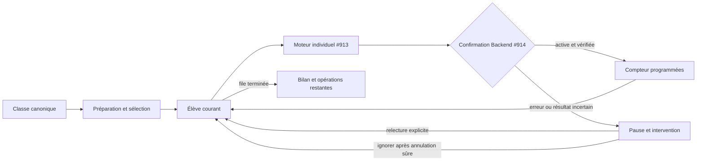

# NFC-PROG-04 — Android — Programmation NFC en série par classe

13 octobre 2026. **DRAFT / HOLD — NO READY — NO MERGE.**
Développement autorisé sur branche isolée. Diff CTO indépendant requis.

## Provenance

Branche : `codex/nfc-prog-04-android-batch`, depuis #914
`01d2ebc95c84c68d2c23ba03490ff1f77c634fc0`.
Les dépendances ont été contrôlées directement sur GitHub avant modification :

| PR | HEAD | État |
| --- | --- | --- |
| #909 | `91c2af5c5a6255f010fbbbf7f3b5f85a5d04cb22` | Draft / ouverte / non mergée |
| #910 | `c0230910b97a3c6aeb43ac7bd7a5c3b102e77231` | Draft / ouverte / non mergée |
| #912 | `c6f5eaaa23711e4c797f1dac6a764a49f5039096` | Draft / ouverte / non mergée |
| #913 | `db6ca7ec48817dc52740fb64d3bf52229d01ec6a` | Draft / ouverte / non mergée |
| #914 | `01d2ebc95c84c68d2c23ba03490ff1f77c634fc0` | Draft / ouverte / non mergée |

Base GitHub : `develop`. Merge-base contrôlée :
`1bdd302e8ab228d6aaf0bfea3078d9b8361efe1f`.
Le HEAD livré, ahead/behind, inventaire et statistiques sont publiés dans la PR.
**Le diff propre à #04 compare le HEAD #914 ci-dessus au HEAD livré.**
Le diff contre develop inclut les modifications héritées des dépendances.
Aucun fichier Backend/SQL, registre ou gestionnaire NFC partagé n'est modifié
par l'incrément. Les branches sources restent intactes.

## Architecture

- `StudentCardNfcBatchControl` ajoute l'action depuis la carte développée d'une
  classe. Elle ouvre une interface modale Android de préparation, programmation
  et bilan, sans nouvelle route/navigation ni nouveau système de rôles.
- `studentCardNfcBatchRoster` valide le catalogue canonique et la liste spécifique
  à la classe. UUID de classe, code de classe et UUID d'établissement sont exigés.
  Les noms de classe ne servent jamais de clés. Les codes d'établissement du
  catalogue doivent appartenir aux alias connus de la session authentifiée.
- Les élèves sont identifiés par `studentUuid`, conformément à la projection
  Backend dont `id` peut être un code public. Le parser conserve uniquement UUID,
  nom et identifiant affichable. Toute ligne étrangère ou incohérente fait refuser
  le chargement ; aucune liste générale d'élèves n'est utilisée.
- `createNfcBatch` orchestre une file séquentielle de moteurs individuels
  **`createIndividualNfcFlow` de #913**, un par élève pour conserver son intention
  incertaine en RAM. Tous utilisent le même encodeur natif et le gestionnaire
  partagé #909. Aucun autre moteur d'écriture ni bibliothèque n'est ajouté.
- Le contexte de classe est rechargé avant chaque tentative et chaque appel
  du moteur individuel, notamment avant la confirmation. Les services Backend
  #912/#914 restent responsables du RBAC, du tenant, des flags, du TTL et de
  l'activation transactionnelle avec UUID de réservation.

## Accès et interface

Authentification scolaire identifiée, READ+UPDATE Élèves, permissions effectives
`ready`, source de mutations autorisée, écran Classes au premier plan et Android
sont exigés. Les rôles plateforme, parents et élèves restent exclus par le helper
#913. Aucun `ALL_PRIVILEGES` plateforme ne rend cette action accessible.
Le probe vérifie le roster, `nfcEnabled===true` via les cartes d'un élève, puis
NFC supporté/activé. Une classe vide explique qu'aucun élève n'est programmable.
Il n'utilise ni les permissions Présences pour lire les capabilities du scanner,
ni les permissions Paramètres pour récupérer les flags de programmation.

Préparation : nom/code de chaque élève, état canonique de ses cartes, sélection
individuelle, sélection de tous les **nouveaux éligibles**, désélection et compteur.
Une carte active est exclue de la sélection automatique. Une réservation pending
se sélectionne explicitement pour reprise. Une carte active peut être relue pour
résoudre une ancienne confirmation incertaine, ou remplacée après un dialogue
explicite ; l'ancienne reste active jusqu'à la bascule transactionnelle.

Programmation : classe, élève courant, phases NFC, messages du pont natif,
compteurs, pause, reprise, ignore et terminaison. Le bouton Android Retour et la
fermeture du bilan attendent la terminaison sûre ; ils ne ferment pas brutalement
une opération NFC en cours. Développer une autre classe ou changer le périmètre
remonte un composant isolé ; perdre le focus/droits démonte le modal et invalide
l'ancien contrôleur.

Bilan : même liste sélectionnée avec réussites, erreurs, ignorés et réservations
incomplètes. Les erreurs nécessitent une intervention explicite avant de poursuivre.
Ignorer permet de traiter les élèves suivants sans effacer l'opération précédente.
Les opérations ignorées peuvent être reprises individuellement.

## États et compteurs

États d'élève exclusifs : queued, processing, confirmed, error, skipped.
Le booléen `selected` fixe la population des compteurs. Une réussite n'est marquée
qu'après la réponse active/encoded ou active/locked validée par le moteur individuel.
Le retour natif d'écriture et une simple liste de cartes actives ne suffisent pas.

- `Total = Programmées + Restantes`.
- `Restantes = queued + processing + error + skipped`, parmi les sélectionnés.
- `Erreurs` est un sous-ensemble de Restantes : erreurs et ignorés portant encore
  une erreur non résolue. Il ne s'ajoute pas aux Restantes.
- `En cours` vaut 0 ou 1 ; aucun second élève n'est lancé avant la fin et la
  libération des ressources du précédent.

Les cartes précédemment confirmées sont recontrôlées lors d'une actualisation :
révocation/remplacement/divergence les rend à traiter. Le bilan garde les élèves
sélectionnés retirés de la classe comme erreurs anonymisées ; ils ne peuvent plus
être programmés. Un refus de droits/tenant masque les données élèves affichées.

## Pause, concurrence et reprises

Une seule promesse de file est active. Les doubles starts et actions concurrentes
sont refusés. Chaque appel individuel capture une génération et l'UUID de l'élève
courant. Pause, fin, déconnexion, arrière-plan, changement de classe/périmètre et
fermeture invalident cette génération. Une réponse tardive ne marque aucune carte
comme programmée et ne déclenche jamais l'élève suivant.

La pause entre d'abord dans `pausing`, ferme le lease de cet encodeur et attend
**à la fois** l'opération individuelle et la fermeture native. Un échec de nettoyage
bloque tout nouveau départ jusqu'à une annulation explicite réussie. La quarantaine
et l'exclusivité natives restent celles de #909, y compris face au lecteur.

La reprise recharge l'état Backend. Le moteur conserve la même intention UUID
si la réponse de réservation est inconnue. Une réservation existante se reprend
par relecture/confirmation, sans écriture ou rotation automatique. Une puce vierge
ou une ancienne capability à renouveler impose **Renouveler et réécrire avec
confirmation**, avec dialogue explicite. L'UUID transmis à confirmation reste
celui de réservation, distinct du retry, validé par #914. L'expiration serveur
est affichée et refusée ; aucun TTL n'est prolongé ni UID historique recyclé.

Aucune sélection, secret, NDEF ou capability n'est persisté. Les snapshots
whitelistent les métadonnées et n'incluent ni token ni hash. Les erreurs sont
traduites en messages fixes. Quelques codes d'erreur #914/flags/RBAC ont été
ajoutés au dictionnaire partagé #913, sans modification du moteur d'écriture.

Après fermeture complète : recharger la classe et les cartes, **resélectionner**
explicitement les élèves restants/pending, ou vérifier une carte devenue active
après une réponse perdue. L'ordre et les compteurs de l'ancien batch ne sont pas
persistés. Le nouveau bilan se construit à partir de cette nouvelle sélection
et des confirmations canoniques ; aucune ancienne carte active n'est comptée
comme une nouvelle programmation par défaut. Aucun stockage Backend batch ajouté.

## Contrat API utilisé

Tous les appels passent par le client HTTP authentifié et son scope canonique.
Les lectures de roster utilisent `cache:no-store` et aucune projection L1 offline.

| Route existante | Usage |
| --- | --- |
| `GET /api/classes` | UUID/code de classe et catalogue autorisé |
| `GET /api/classes/:classCode/students` | inscriptions canoniques de cette classe |
| `GET /api/students/:studentUuid/cards` | cartes, état de réservation et flag NFC strict |
| `POST /api/student-cards` | réservation `{studentId, medium:"nfc", nfc:{uid,tagType}, operationId}` |
| `POST /api/student-cards/:previousId/replace` | même réservation pour remplacement explicitement choisi |
| `POST /api/student-cards/:id/nfc-retry` | rotation explicite `{uid,tagType,operationId}` avec UUID de retry |
| `POST /api/student-cards/:id/nfc-confirm` | `{uid,tagType,cardToken,locked,studentId,operationId}` ; UUID de réservation |

Pas de route présence/finance/transport, pas de révocation anticipée. L'inspection
UID/modèle et NDEF vierge précède la réservation car #912 exige cette identité.
NDEF canonique inchangé, relecture fraîche après retrait/représentation et aucun
verrouillage irréversible, conformément à #913.

## Vérification

- **45/45 tests batch** : classe vide, sélection/désélection, actifs exclus,
  trois élèves successifs, unicité de session, compteurs, erreur sur deuxième et
  reprise/ignore, contenu/carte incohérents, UID associé, lecture seule, expiration,
  réseau/UUID/flags, réponse perdue après activation, pause avant réponse et pendant
  écriture, cleanup échoué, doubles clics, ancien callback, logout/classe changée,
  refus RBAC masquant les données, reprise après redémarrage, absence de secret,
  remplacement et reçus revalidés après actualisation.
- **52/52 tests individuels**, **15/15 tests session/pont natif**, lecteur NFC/QR : PASS.
- TypeScript, sécurité Mobile : PASS.
- PostgreSQL 16 local jetable : **43/43 tests** (36 lifecycle, 1 SQL, 6 unitaires)
  et **7/7 runners** registre/lifecycle/resolve/présence/finance/HTTP/scan : PASS.
- Le gate LOT4 ajoute uniquement les chemins exacts du point d'entrée Classes
  et de ce rapport, avec le cas de périmètre ; aucun wildcard supplémentaire.
- Le job CI Android hérité exécute maintenant aussi `test:student-card-nfc-batch`
  au HEAD exact. Les résultats CI finaux sont relevés dans la description de PR.

## Risques et dépendances avant merge

Diff indépendant du CTO, revue des dépendances #909/#912/#913/#914 et du contrat
#910 requis. Les validations automatiques ne constituent aucune approbation Ready
ou merge. Aucun déploiement ni migration distante.

Les lectures par élève et revalidations de roster coûtent plusieurs requêtes ;
la préparation de grandes classes et la latence réseau doivent être mesurées.
Le contrat API protège atomiquement la carte/l'élève/l'établissement, **pas**
l'appartenance à la classe : un changement d'inscription entre le dernier GET
et le POST reste possible. Les revalidations réduisent cette fenêtre sans modifier
le Backend ni prétendre ajouter une contrainte transactionnelle de classe.

Après perte d'une réponse avant visibilité serveur et fermeture du processus,
il n'existe pas de journal durable d'intention Mobile. La reprise repose sur la
liste canonique et les contraintes de réservation unique/UID historique de #912.
Une annulation native définitivement défaillante peut nécessiter un redémarrage
Android/application ; le gestionnaire refuse le transfert d'une session incertaine.

**Recette physique NTAG213/216 : NON EXÉCUTÉE.** UI/RF réels, trois cartes successives,
retrait/représentation, téléphone éloigné, arrière-plan/arrêt forcé, UID déjà utilisé,
expiration, remplacement échoué, réponse réseau perdue et pause/ignore pendant une
opération restent à tester sur un téléphone avec un Backend déployé compatible.
Le jeton statique reste clonable ; il ne constitue pas une authentification forte.

Aucun multi-scan/appel collectif, contrôle d'impayés, transport, paiement, iOS,
MIFARE Classic, impression physique ou verrouillage. **NFC-PROG-05 interdit sans
nouvelle autorisation CTO.** Développement arrêté à la livraison de cette PR.

**DRAFT / HOLD — NO READY — NO MERGE.**
