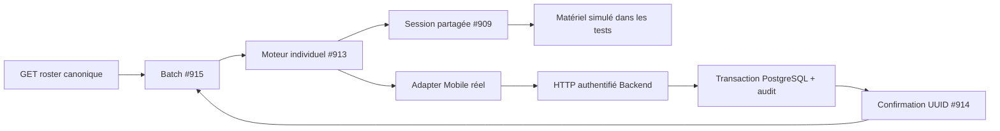

# NFC-PROG-05 — Intégration finale, sécurité et préparation Android

13 octobre 2026. **DRAFT / HOLD — DIFF CTO REQUIS — NO READY — NO MERGE.**

Le parcours Mobile est testé contre les véritables routes HTTP authentifiées et
une base PostgreSQL 16 locale jetable. Les contrats NFC ciblés passent. Deux
défauts de protection ont été reproduits puis corrigés. Deux anciens contrôles
Backend hors NFC restent rouges, avec le même résultat sur #915 : aucune
déclaration « toutes les non-régressions du dépôt passent » n'est faite.
**Recette physique, installation APK, déploiement et migration distante : NON EXÉCUTÉS.**

## Références et périmètre

Branche isolée : `codex/nfc-prog-05-integration-readiness`, créée depuis #915
`051751e6c7412d78546ec33596ca7dec774e925c`. Base GitHub `develop`, merge-base
`1bdd302e8ab228d6aaf0bfea3078d9b8361efe1f`. HEAD livré, ahead/behind, inventaire,
diff incrémental, CI et APK sont relevés dans la description de la PR au SHA exact.

Contrôle indépendant avant modification :

| PR | HEAD contrôlé | Ascendance de #915 |
| --- | --- | --- |
| #909 | `91c2af5c5a6255f010fbbbf7f3b5f85a5d04cb22` | oui |
| #910 | `c0230910b97a3c6aeb43ac7bd7a5c3b102e77231` | non, contrat documentaire indépendant |
| #912 | `c6f5eaaa23711e4c797f1dac6a764a49f5039096` | oui |
| #913 | `db6ca7ec48817dc52740fb64d3bf52229d01ec6a` | oui |
| #914 | `01d2ebc95c84c68d2c23ba03490ff1f77c634fc0` | oui |
| #915 | `051751e6c7412d78546ec33596ca7dec774e925c` | référence directe |

Toutes ouvertes, Draft, non mergées ; même merge-base develop. Les branches
sources n'ont pas été modifiées. Le diff propre à #05 compare le HEAD livré à
#915, et non à develop. Les 73 fichiers cumulés de #915 sont hérités.

Changements propres : redaction du logger, listes de cartes non cacheables,
tests d'intégration/sécurité et leur fixture, pipeline de preuves APK renforcé,
scripts de test et deux rapports. Aucun nouveau schéma, migration, route,
registre batch, moteur NFC, dépendance ou fonctionnalité métier.

## Défauts corrigés et preuves

| Défaut reproduit | Avant | Correctif minimal | Régression |
| --- | --- | --- | --- |
| Le logger général reconnaît JWT/push mais laisse une capability NFC dans texte, Error, objets/arrays ; cardToken/token_hash/capability ne sont pas des clés sensibles | 9/12 cas de sécurité échouent, sans imprimer le secret dans les assertions | Redaction du format canonique et des clés sensibles, y compris Error.message ; sanitizer utilisateur refuse ce format | 13/13, incluant les protections déjà présentes dans nfcErrorCopy |
| GET canonique des cartes sans Cache-Control no-store, adapter Mobile sans consigne cache | Intégration 14/15 : test HTTP de non-cache échoue | En-tête sur GET /students/:id/cards et cache:no-store dans l'adapter partagé | HTTP réel + test des options du client |

Ces tests démontrent une lacune de protection **si une capability est transmise
au logger** ; ils ne prouvent pas qu'un secret a été journalisé en production.
Les moteurs NFC n'appellent pas ce logger. Le durcissement protège également
les diagnostics génériques. Les versions et SDK du binaire APK sont désormais
comparés à la configuration embarquée, et les URLs API de production sont refusées
dans les assets/Dex inspectés. Le contrat NFC et le format NDEF restent identiques.

## Architecture d'intégration et contrat

`studentCardNfcIntegration.pg.test.ts` importe les vrais `createNfcBatch`,
`createIndividualNfcFlow`, `createNfcEnrollmentApi`, `createBatchRosterLoader`
et `createNfcSessionManager`. Le transport de test fait des fetch HTTP locaux
avec des JWT synthétiques, vers `backend/server.js` et le repository complet.
Il ne remplace ni les services NFC Backend ni leur logique transactionnelle.
Seul le dispositif RF est simulé : UID/modèle, contenu NDEF, session et annulation.

`studentCardsNfcIntegration.fixture.js` refuse une URL distante, exige l'URL
de test explicite, crée une base au nom aléatoire `nfc_prog_05_<UUID>`, initialise
le vrai repository et ses schémas, et génère les identifiants élèves avec le trigger
canonique. Il démarre son propre Backend, puis arrête ce processus, ferme les pools
et supprime uniquement cette base. Aucune utilisation d'un service préprod/production.

| Route existante | Contrat utilisé |
| --- | --- |
| GET /api/classes et /classes/:classCode/students | classe et inscriptions scolaires canoniques |
| GET /api/students/:studentUuid/cards | métadonnées sans token/hash, nfcEnabled strict, sans cache |
| POST /api/student-cards | studentId, medium nfc, nfc:{uid,tagType}, operationId de réservation |
| POST /api/student-cards/:previousId/replace | même identité/reservation UUID ; source reste active |
| POST /api/student-cards/:id/nfc-retry | uid, tagType, operationId de retry distinct ; même reservation UUID/expiry |
| POST /api/student-cards/:id/nfc-confirm | uid, tagType, cardToken, locked, studentId, UUID de réservation |
| POST /api/student-cards/:id/revoke | révocation canonique, effective pour les confirmations/replays |

Réservation issued/pending non utilisable, TTL serveur de 30 minutes. Un replay
de réservation ne renvoie pas de token ; le Mobile lit la capability sur la puce.
Une puce vierge impose une rotation **explicitement consentie**. Retry ne prolonge
pas l'expiration, ne change pas l'UUID de réservation et ne recycle pas l'UID.
Confirmation et remplacement passent par la transaction PostgreSQL et son audit.
Une réponse perdue ne suffit jamais à incrémenter la réussite Mobile.
Compatibilité anciennes cartes active/encoded avec UUID null et QR couverte par
les suites héritées ; aucun UUID arbitraire n'est attribué à une carte legacy.

## Audit de sécurité

- Authentification réelle, RBAC live, tenant et flags contrôlés sur les routes.
  L'autre établissement ne peut ni consulter ni réserver pour l'élève externe,
  ni confirmer/révoquer/remplacer/retry sa carte. Enseignant sans UPDATE,
  Superadmin et Admin Pays refusés, même avec des privilèges plateforme.
- UUID absent/divergent, mauvais élève, UID, modèle ou token : refus et aucune
  mutation des cartes/audits. Flag désactivé, réservation révoquée et expiration :
  aucune activation. L'expiration correcte peut révoquer/auditer la réservation
  expirée conformément au contrat ; ce refus est une mutation de nettoyage prévue.
- Hash SHA256 stocké, comparaison du secret, UID historique unique, une seule
  active et une seule pending par élève, locks et contraintes PostgreSQL.
  Confirmation/retry/révocation concurrents et échec SQL d'audit : suites héritées.
- Les tokens/secrets générés sont recherchés dans cartes, audit, idempotency et
  logs capturés du Backend ; zéro occurrence en clair. Aucune réponse secrète
  mise en cache dans idempotency_keys. Snapshots Mobile sans capability/hash.
- Inspection des moteurs : aucune persistance AsyncStorage/SecureStore/SQLite,
  outbox, logging NDEF ou commande makeReadOnly. Les captures physiques doivent
  masquer toute capability ; aucun NDEF brut ne sera joint au dossier de recette.
- Une capability statique reste clonable. UID public, verrouillage non probant
  pour l'authentification forte, capability révocable. Aucun lock irréversible.

## Matrice des validations automatisées

| Scénario | Preuve exécutée | Résultat |
| --- | --- | --- |
| A individuel | moteur Mobile, write/read simulés, HTTP, activation PG/hash et audit unique | PASS |
| B 30 élèves | vraie classe/inscriptions, NTAG213/216 simulées, une session, aucune active lors du write, audit et compteurs exacts | PASS |
| C erreur 11e | 10 actives, 11e issued après écriture, réponse réseau refusée, relecture explicite puis jusqu'à 30 | PASS, 30 écritures au total |
| D réponse confirm perdue | commit PG actif mais compteur Mobile 0 ; même UUID, canonique et replay | PASS, aucun nouvel issue/retry/write/audit |
| E remplacement | consentement requis, A active durant erreur/écriture B, bascule après confirm, liens historiques | PASS |
| F sécurité | matrice HTTP tenant/RBAC/UUID/identité/flags/expiry/revoke et états SQL avant/après | PASS |
| Fermeture, carte active | contrôleur détruit, rechargement réel, resélection de vérification | PASS, zéro écriture/réservation |
| Fermeture, pending vierge | réponse issue perdue, canonique, reprise refuse blank, retry explicite distinct puis encode | PASS, UUID/expiry inchangés |
| Pause pendant write | vraie lease en attente, pause attend sa fin, aucun élève suivant ni activation anticipée | PASS, reprise par relecture |
| Transfert avant dernière lecture | canonique ne contient plus l'élève avant confirm | PASS, zéro POST confirm |
| Transfert entre GET et POST | race déterministe reproduite | LIMITATION V1 documentée ci-dessous |
| Migrations existantes | fichiers SQL 12/13 octobre exécutés deux fois sur base jetable | PASS, carte encodée préservée |
| Secrets/effets métier | SQL/logs/snapshots contrôlés, zéro présence/paiement/obligation/allocation | PASS |

Totaux : **17/17 intégration**, **13/13 sécurité**, **52/52 individuels**,
**45/45 batch**, **15/15 session/pont natif**, lecteur NFC/QR PASS.
TypeScript, sécurité Mobile, scope élèves/classes, accès paramètres : PASS.
Gate LOT4 : PASS (seuls chemins exacts logger et rapports ajoutés à l'allowlist).
Vérificateur APK : **5/5 tests Python**.

PostgreSQL : **43/43** (36 lifecycle + 1 SQL + 6 unitaires), sans skip, **7/7**
runners carte hérités, plus **3/3** runners classes/inscriptions/paramètres.
Backend sélection élèves/classes/cartes/paramètres : **83 tests PASS**,
avec le runner legacy décrit ci-dessous en échec ; auth **28+13 PASS**,
plateforme **62 PASS**, RBAC S1.4 PASS. Aucun test distant ni migration distante.

### Échecs hérités, reproduits au parent exact

Deux vérifications ne passent pas, avant comme après #05. Le Backend au SHA #915
a été exporté dans un dossier temporaire, avec les mêmes dépendances ; les deux
commandes retournent les mêmes erreurs. Aucun fichier de ces contrôles n'est modifié.

1. `node backend/lib/studentsSyncRepository.test.js` attend saveBackOfficeState ;
   le repository refuse désormais cette écriture globale avec 410
   `BACKOFFICE_STATE_WRITE_REMOVED`.
2. `npm run verify:rbac-admin-01` attend teachers dans ADMIN_SCHOOL_WRITABLE_ENTITIES ;
   l'écriture enseignants est passée aux APIs dédiées et n'y figure plus.

Ces anciens scripts ne démontrent pas une régression NFC. **Décision CTO requise**
sur leur maintenance séparée ou leur statut de prérequis ; aucune réouverture du
BackOffice global pour faire passer les tests. Les résultats CI finaux sont
publiés dans la PR, sans masquer ces résultats locaux.

## Performance locale, sans mesure radio

Un passage final, HTTP loopback/PostgreSQL 16, données synthétiques ; temps mesurés
avec performance.now, après le seed. Aucun benchmark de téléphone/Android/RF.

| Élèves | Préparation ms | Orchestration ms | Total ms | API GET / POST | Réponses octets |
| --- | ---: | ---: | ---: | --- | ---: |
| 10 | 165,76 | 852,67 | 1 018,43 | 112 / 20 | 409 459 |
| 30 | 158,44 | 1 909,42 | 2 067,86 | 332 / 60 | 3 287 578 |
| 50 | 188,33 | 2 891,74 | 3 080,07 | 552 / 100 | 8 914 337 |

Nombre d'appels : 13N+2, mutations 2N, écritures N et max de leases 1.
Les relectures répétées de roster conduisent à des volumes croissant environ
quadratiquement : **8,9 Mo de réponses à 50 élèves** dans cette fixture.
Latence WAN, coût d'un établissement avec beaucoup de classes et réseau mobile
à mesurer en recette. Aucun cache non canonique introduit pour améliorer ces chiffres.
La CI joint également ses mesures assainies ; ses temps peuvent différer.

## Appartenance classe et redémarrage — décision technique proposée

Le test de race transfère l'inscription **après** le dernier GET mais **avant**
le POST confirm. Backend confirme la carte du même élève, dans le même établissement ;
le prochain refresh batch retire l'élève transféré du compteur de réussite.
Il n'existe pas de liaison transactionnelle carte/classe dans le contrat actuel.

**Recommandation V1 : accepter cette limite de cohérence de sélection, sous décision
CTO**, pour les utilisateurs ayant les droits scolaires de programmation. La
classe fournit la population de travail ; la carte reste attachée à l'élève et
à l'établissement. Le test ne franchit aucun tenant et ne change pas l'affectation
de la carte à son élève. Avant le dernier GET, le transfert est bien bloqué.
Exiger qu'une mutation soit atomiquement liée à la classe demanderait un contrat
Backend supplémentaire, à signaler/autoriser avant implémentation. Aucune nouvelle API.

Après fermeture, resélection canonique acceptable V1 : les trois cas active après
réponse perdue, pending vierge et pause pendant écriture passent. Pas de compteur
persisté ni de réussite inférée à partir des anciennes cartes actives. Une intention
avant visibilité serveur et disparition du processus n'a pas de journal durable ;
la reprise repose sur PostgreSQL et les contraintes de réservation/UID existantes.

## APK, recette et dépendances avant intégration

Le pipeline hérité construit au HEAD exact, profil preview, API strictement
`https://api-preprod.somafrik.app`, ARM64, package com.somafrik.app, signature de test.
Il vérifie configuration embarquée, bundle, version/code, SDK, permissions NFC
optionnelles, backup/cleartext/debug refusés, signature, patterns secrets et
absence d'URL API production dans les entrées inspectées. Empreinte **du binaire**,
certificat et manifeste sont joints à l'artefact ; l'empreinte de l'archive GitHub
est une autre empreinte. La PR fournit les valeurs finales extraites au même SHA.
Une recherche de patterns ne constitue pas une preuve exhaustive d'absence de secrets.

[Protocole physique préparé, NON EXÉCUTÉ](NFC-PROG-05-PHYSICAL-RECIPE.md).
L'APK final de recette doit être choisi par le CTO. Backend avec #912/#914 et base
de recette doivent être préparés sous une autorisation ultérieure ; aucune requête
à la préproduction et aucun déploiement n'ont été faits dans ce lot.

Proposition de séquence, **aucune exécution autorisée** :

1. Diff CTO indépendant de #05 au HEAD exact et décision sur les deux scripts
   hérités, la race de classe et le volume réseau. Vérifier aussi les diffs sources.
2. Clôture documentaire #910 selon décision administrative, sans la confondre
   avec une dépendance de code dans l'ascendance.
3. Intégration de la chaîne #909 → #912 → #913 → #914 → #915 → #05, ou de son
   HEAD cumulé après revue, selon la stratégie CTO. Ces PR ciblent develop et ont
   des diffs cumulés : ne pas cherry-pick chacun de leurs diffs complets.
4. Après chaque intégration autorisée, recalculer HEAD/merge-base et CI ; aucun
   résultat de ce candidat ne garantit le futur commit de merge.
5. Sous nouvelle autorisation, environnement recette compatible, migrations
   testées/restauration, sélection APK puis installation et recette individuelle/batch.

Avant merge : revue indépendante, CI au HEAD livré, décisions CTO précédentes,
validation de toute la chaîne. Avant production : recette réelle NTAG213/216,
performance réseau/téléphone, annulation/arrêt forcé, politique de release et
signature de production, validation du cycle de vie et plan d'exploitation/migrations.
Une annulation native définitivement défaillante peut nécessiter un redémarrage ;
la session reste quarantinée. Capability clonable, resélection après fermeture et
ordre/compteurs non durables demeurent des limites connues.

**DRAFT / HOLD — DIFF CTO REQUIS — NO READY — NO MERGE.**
